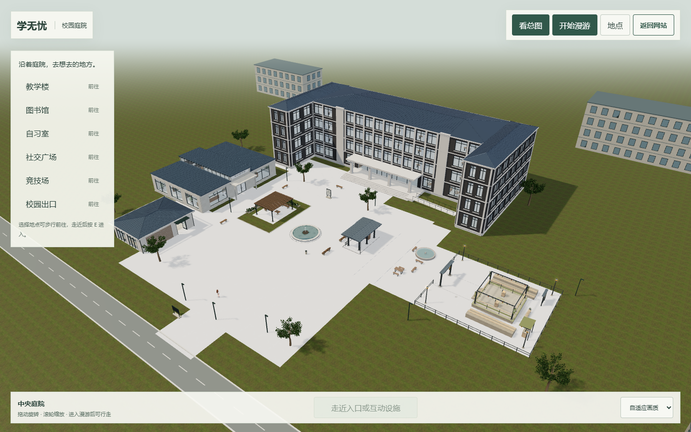

# 学无忧 · 3D 开放校园与在线学习

学无忧将可探索的三维校园与在线学习工具结合：走进教室练题，到图书馆阅读，在自习室与同伴专注，也可以在广场交流、到竞技场进行答题挑战。校园空间与原网站共用账号和学习业务，用户可以按自己的习惯选择空间入口或清晰的网页列表。

**[打开网站](https://dallovers.github.io/xuewuyou/) · [进入 3D 校园](https://dallovers.github.io/xuewuyou/js/features/campus-hub/index.html) · [前往竞技场](https://dallovers.github.io/xuewuyou/js/features/campus-hub/index.html?at=arena)**



## 校园里可以做什么

中央庭院连接五处功能空间。教学楼、图书馆和自习室可以直接步行进入，社交广场与竞技场沿室外道路连通。

| 空间 | 互动与学习入口 |
| --- | --- |
| 中央庭院 | 漫游、导览、长椅休息、开关圆形喷泉；通过校园出口或“返回网站”回到主站 |
| 教学楼 | 开门、入座、控制灯光、卷帘和投影；在课程面板选择科目，或入座后按 E 进入正式题库 |
| 图书馆 | 书架分类、馆藏检索、资料阅读、阅读计时、书签和摘记 |
| 自习室 | 入座、拿书、翻书；从签到台进入网站自习房间，设置目标，与同伴共同计时 |
| 社交广场 | 从学习搭子服务台和留言板打开好友、邀请、校园留言与回复 |
| 竞技场 | 走近甲、乙作答位按 E 参与现场匹配；匹配后作答同一组五道题，交卷查看服务端判分和结果 |

教学楼目前可进入首层门厅和一间示范教室。正式刷题使用主站整页题库；阅读、自习、好友等功能在相应面板中打开。图书馆书签、摘记及部分场景内示范记录保存在当前浏览器，不等同于账号云端学习记录。

校园中还保留少量彩蛋与隐藏互动，欢迎自行探索。

## 人物、皮肤与同场互动

- **人物与动作**：支持二次元、学生、机器人、卡通等形象。可在皮肤商城查看实际三维模型、旋转预览并试播动作；各模型支持的动作不同，以可用按钮为准。
- **学习币与换装**：初始形象可免费使用；登录后可兑换、穿戴皮肤，余额和衣橱随账号保存。正式题库中，可由服务端自动判分的选择题，每题每天首次答对奖励 10 学习币，每日上限 200，按北京时间计算。
- **多人同场**：不同账号连接同一后端并加入同场后，可以看到附近同学的人物、移动、动作和换装。同一账号新窗口加入时会接替旧窗口。
- **聊天与头顶气泡**：点击“聊天”或按 Enter 输入，发送内容同时出现在聊天栏和可见角色头顶。聊天面向当前校园同场用户，记录为临时保存。
- **答题竞技**：现场匹配无需先加好友；两位用户分别操作作答位即可进入匹配。主站仍保留邀请学习搭子的异步五题挑战。挥拳等人物动作属于表现动画，竞技结果由答题判分决定。

## 主网站功能

不进入 3D 场景，也可从主站导航使用学习工具：

| 导航 | 功能 |
| --- | --- |
| 今日校园 | 3D 校园入口、学习概况与常用功能 |
| 课程与资料 | 课程目录、题库练习、随机组卷、学习资料、AI 助手 |
| 错题与复习 | 错题归集与重做、FSRS 智能复习、学情报告、AI 备考计划入口 |
| 自习室 | 个人自习、公开或邀请制多人房间、共同目标与计时 |
| 同伴 | 学习搭子、邀请确认、留言和回复、好友答题挑战 |

多人共同计时需至少两位成员在线并准备，由房主开始；离开页面、休息或断线会影响有效计时。AI 回答取决于后端模型配置。资料上传后的解析、索引与基于资料的问答需要额外服务，见下方配置说明。

## 基本操作

| 操作 | 桌面端 |
| --- | --- |
| 移动 / 快跑 | WASD 或方向键 / 按住 Shift |
| 调整视角 / 跳跃 | 拖动画面 / 空格 |
| 使用设施 | 靠近后按 E，或点击底部互动按钮 |
| 切换附近目标 | F，或点击“附近互动”中的目标 |
| 招呼 / 挥拳 | Z / X，依当前形象支持的动作 |
| 聊天 | Enter 打开并发送，Shift + Enter 换行 |
| 关闭当前面板 / 起身 | Esc |

手机提供方向、跳跃和互动按钮。顶部地点菜单可选择步行导航或“移动”到入口。需要刷题时，先到教室入座，再按 E；需要现场对战时，请进入整合校园的竞技场作答位。旧独立竞技场页提供“去台上坐下答题”入口。

## 本地运行

需要 **Node.js 22.12 或更新版本**。仓库已包含校园构建产物，体验现有场景无需安装 Blender。

### 推荐：隔离本地预览

在仓库根目录执行：

```powershell
npm ci --prefix server
node server/scripts/campus-preview-dev.cjs
```

打开 [本地校园](http://127.0.0.1:4184/js/features/campus-hub/index.html) 或 [本地主站](http://127.0.0.1:4184/)。预览脚本将前端连接到同一个本地后端，默认使用 `server/data/campus-hub-preview` 保存隔离数据；请注册本地测试账号。该方式不读取 `server/.env`，运行环境也不要设置生产 `DATABASE_URL`。多人体验可使用普通窗口和无痕窗口，分别登录不同账号。

### 完整站点与学习引擎

Windows 可运行根目录的 `启动网站.cmd`，它会安装依赖并准备 Python 学习引擎。此方式还需要 **Python 3.10–3.14**。也可手动启动后端：

```powershell
cd server
if (!(Test-Path .env)) { Copy-Item .env.example .env }
npm ci
npm start
```

默认访问 [http://localhost:3000](http://localhost:3000)。使用完整启动方式进行本地开发时，还需将本地 `js/deploy-config.js` 的 `apiBase` 设为 `http://localhost:3000`，使前端连接本地 API；仓库发布配置默认指向线上后端。

需要 Python 学习引擎时，在仓库根目录运行 `services/Setup-Learning.ps1`；Linux/macOS 可按 `services/learning/requirements.txt` 创建虚拟环境，并通过 `LEARNING_PYTHON` 指定解释器。

### 修改校园源码后重建

```powershell
npm ci --prefix js/features/campus-hub
npm run build --prefix js/features/campus-hub
```

源码与构建入口位于 `js/features/campus-hub/`。直接双击 HTML 无法运行完整网站；请通过 HTTP 服务打开。

## 服务配置与部署

线上前端和 3D 资源由 **GitHub Pages** 提供，API 与实时连接由 **华为云后端**提供。`js/deploy-config.js` 统一配置 API 地址。GitHub Pages 本身不运行 Node 服务，合并前端代码也不会自动更新华为云后端镜像。

| 配置 | 用途 |
| --- | --- |
| `PORT`、`HOST` | Node 服务端口与监听地址 |
| `DATA_DIR` | 本地 JSON 模式的数据目录 |
| `DATABASE_URL`、`JWT_SECRET` | PostgreSQL 存储与登录校验；数据库模式需固定登录密钥 |
| `AI_PROVIDER`、`AI_API_KEY`、`AI_BASE_URL`、`AI_MODEL` | 站内 AI 助手与生成式回答 |
| `RAGFLOW_BASE_URL`、`RAGFLOW_API_KEY` | 课程资料索引、检索与资料问答，需在 RAGFlow 配置 Embedding 模型 |
| `MINERU_BASE_URL`、`MINERU_API_KEY`、`MINERU_TIER` | PDF、Office、图片等上传资料的解析服务 |
| `LEARNING_PYTHON` | 可选 Python 学习引擎解释器路径 |

配置模板见 [`server/.env.example`](server/.env.example)。密钥只放在服务端环境中。题库、错题、FSRS、社交、人物同场和学习币不依赖外部生成模型；TXT/MD 文本解析可独立使用。已有资料的浏览与阅读，不要求用户自行部署解析模型。

可选服务的启动脚本为 [`services/Setup-RAGFlow.ps1`](services/Setup-RAGFlow.ps1) 和 [`services/Start-MinerU.ps1`](services/Start-MinerU.ps1)。知识图、CP-SAT 排程、BKT 和数学实验的历史代码仍保留在仓库中；当前主导航已移除原“学习工作台”入口，不将旧操作路径作为现有菜单说明。

部署操作见 [华为云后端说明](docs/team/huawei-backend.md) 和 [后端镜像发布清单](docs/team/2026-10-24-后端镜像发布清单.md)。Render 部署文件保留作可选方案，当前线上 API 使用华为云。

## 技术与资源

- **网站与服务**：原生 HTML / CSS / JavaScript、Node.js、Socket.IO；支持 JSON 和 PostgreSQL 存储。
- **校园与人物**：Three.js、GLB / glTF、VRM、three-vrm；共享场景统一管理相机、输入和渲染循环。
- **学习工具**：ts-fsrs、KaTeX、markdown-it、Excalidraw；RAGFlow、MinerU 与 Python 学习引擎按需配置。
- **模型来源与授权**：[人物资源清单](docs/characters/INVENTORY.md)、[素材署名](docs/characters/ATTRIBUTION.md)、[来源记录](docs/characters/sources.json)。人物、动作、贴图及第三方代码遵循各自授权，复用时保留相应许可和署名。

## 检查与维护

在仓库根目录执行：

```powershell
npm run check --prefix server
npm test --prefix server
npm run test:presence --prefix server
```

完整服务端测试需要相应 Python 学习引擎环境；数据库专项测试还需独立的测试 PostgreSQL。CI 配置见 [`.github/workflows/verify.yml`](.github/workflows/verify.yml)。校园浏览器专项的运行条件见 [`js/features/campus-hub/README.md`](js/features/campus-hub/README.md)；具体脚本以各目录的 `package.json` 为准。

校园提供多档画质，实际流畅度受设备和网络影响。账号学习数据由后端保存；本地书签、示范笔记、临时同场状态等按各模块的保存方式处理。更新后端时请保留数据库、数据目录和环境配置。
