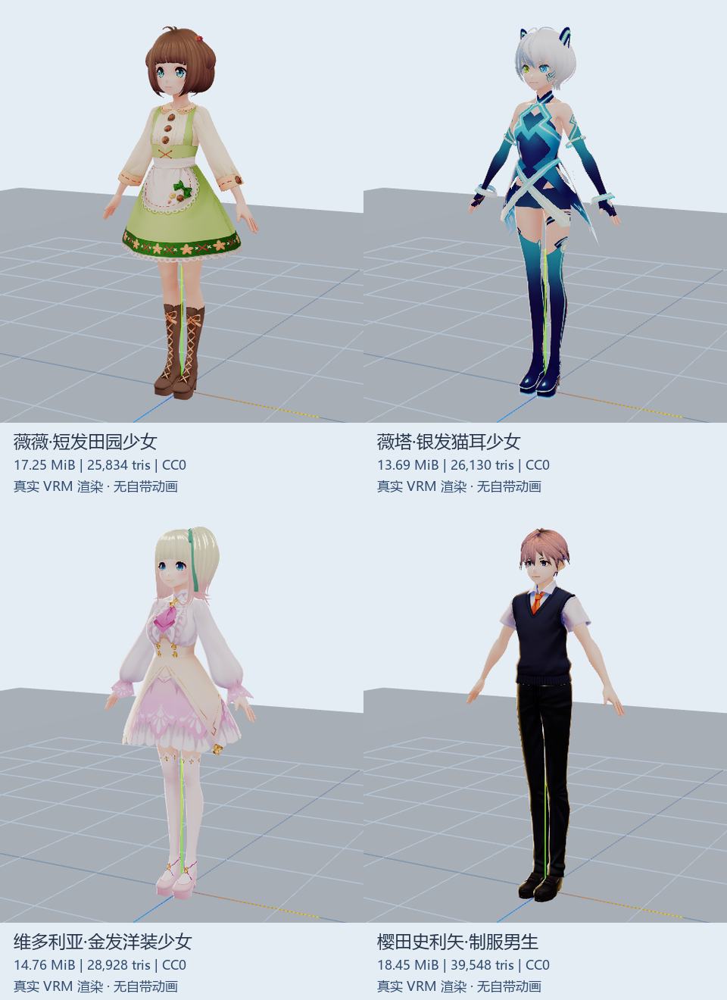

# 学无忧人物资源准备

当前交付 **14 个不同外观、87,663,454 字节 / 83.60 MiB**，包括第一批 10 个卡通/奇幻角色与本次 4 个二次元人形。13 个模型及其贴图为 CC0；Fox 的绑骨、动画与 glTF 转换为 CC-BY-4.0，完整署名见 [ATTRIBUTION.md](ATTRIBUTION.md)。

机甲按用户选择移出当前候选目录与预览；保留 D 盘归档和 Git 历史。当前预览默认选择二次元批次，旧机甲链接刷新后也回到二次元，不自动加载人物。

- [二次元批次与接入建议](ANIME.md)
- [完整人物清单](INVENTORY.md) / [机器可读清单与逐文件 SHA-256](sources.json)
- [现有接口核对](INTERFACE.md) / [实际验证结果](VALIDATION.md)
- [署名](ATTRIBUTION.md) / [排除记录](REJECTED.md) / [弃选机甲历史](WAVE2.md)



本次推荐先看薇塔（银发猫耳）、维多利亚（洋装）、制服男生。新四款均有 VRM 标准人形骨骼，**没有自带动画**；缺少六动作适配，当前只是“可显示”。预览的自然站姿和 T 姿是静态展示，不冒充待机动作。原有 VRM1 动作曾在前三款 VRM0 上出现抬臂异常，已撤下绑定；后续需正确校正坐标与 rest pose。

## 独立预览

在本分支 worktree 根目录执行：

```powershell
python -m http.server 4197 --bind 127.0.0.1
```

访问 <http://127.0.0.1:4197/examples/character-preview/?batch=wave3-anime>，选择人物并点击“加载人物”。已有本地服务器无需重复启动。资源按需加载，切换释放旧模型；校园启动入口不会请求这些候选。

预览复用项目已有 Three.js 0.170.0、three-vrm 3.3.3、GLTFLoader、AnimationMixer，不安装控制框架。VRM0 的 MToon、54 个标准人形映射已验证；在实例上归一至 1.72m、修正 VRM0 朝向，冻结次级 spring bone 并隐藏 outline，以便静态检查；源文件未改变。校园方向、脚底、碰撞和移动仍需后续校准。

```powershell
npm ci --prefix js/features/campus-hub
node tools/characters/build-preview.mjs
node tools/characters/validate-structure.mjs
# 另一个终端启动上述本地服务器，需已安装 Microsoft Edge
node tools/characters/validate-browser.cjs
```

浏览器脚本默认使用 4197，可用 CHARACTER_PREVIEW_URL 设置其他本地地址；CHARACTER_IDS 可筛选 ID，CHARACTER_REPORT 指定报告文件名，默认筛选报告不会覆盖历史首批门禁。本次复用主工作区已有 node_modules 的 ignored junction，未安装新依赖或改 lockfile。

## 重下资源

```powershell
python tools/characters/download-assets.py --cache-dir D:\xuewuyou-cache\characters
# 可选代理 --proxy http://127.0.0.1:7897
# 可选 --force --ids vroid-vita 重新获取一个指定人物
```

下载器仅获取清单中的精确文件；KayKit、Fox、VRoid 使用固定 Git 提交，Kenney 从官方小型 ZIP 精确提取模型和必要贴图，不保存无关资产到发布目录。所有输出严格核对 SHA-256。VRoid 原文件为自包含 VRM（GLB 容器），没有格式转换。原始人物、官方授权页面快照、下载缓存及中间文件均在 D 盘。

## 任务边界

不注册商城或货币系统，不替换默认人物，不改校园 UI、控制器、网络同场、答题/教室流程或任何现有 app.bundle.js。工作在独立 worktree/分支；未触碰另一任务的未提交内容与 tmp。提交 PR，未合并、部署或重启线上服务。
