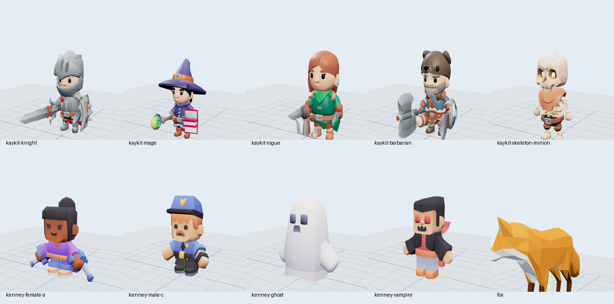
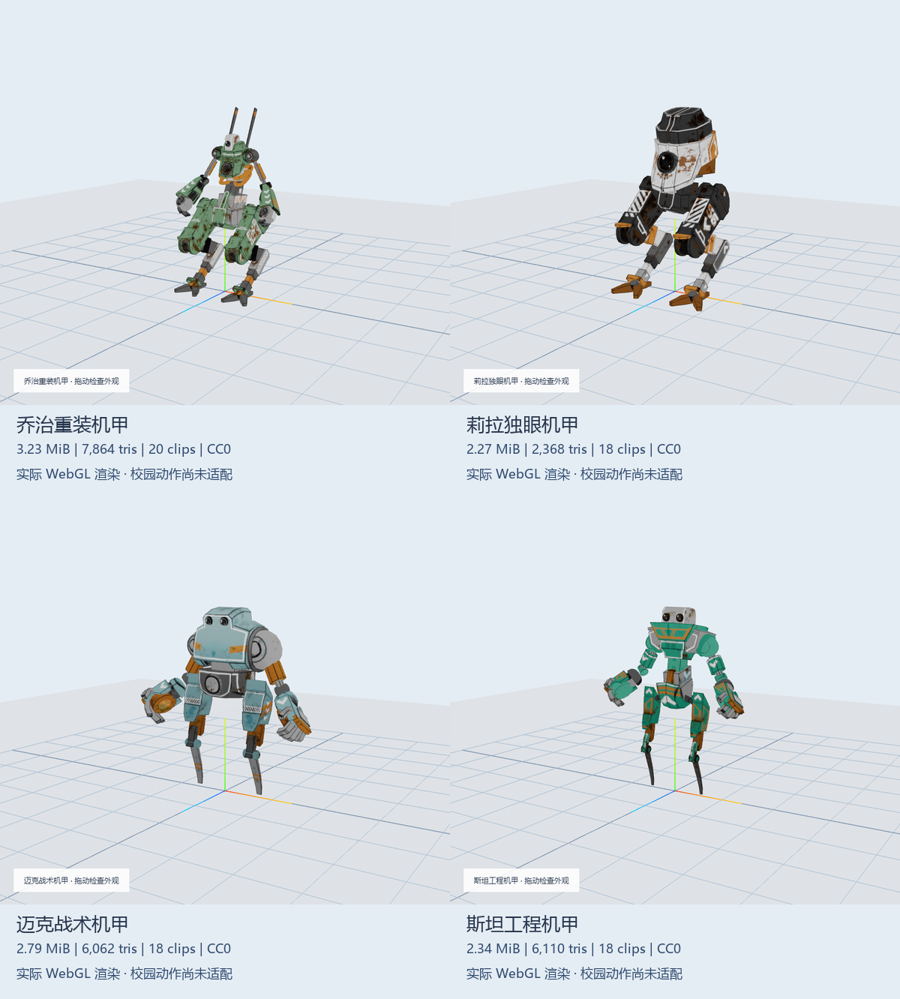

# 验证结果

执行日期：2026-10-24。所有结果来自独立 D 盘 worktree、本地 Python 静态服务器和已安装 Microsoft Edge。没有启动、重启或部署线上服务。

## 首批门禁

先获取 KayKit Knight、Mage、Rogue 三个模型及官方资源包 LICENSE/README。确认每个 GLB 真实包含一套 skin、一张嵌入 PNG、76 段动画；再用现有 Three.js GLTFLoader 在浏览器渲染，采样原生片段。**首批通过后才下载其他人物**。原始首批结果保留在 [batch-1.json](validation/batch-1.json)，截图 [batch-1-contact.png](validation/batch-1-contact.png)。初版预览曾把 URL 对象直接传入 GLTFLoader，出现 TypeError，已改为 `.href` 后首批通过；未用失败结果充数。

## 第二批先验三款再扩充

先下载 Quaternius George、Leela、Mike 与原始授权，完成无损 glTF→GLB 封装、结构与贴图解码，再通过真实浏览器显示和 56 段原生动画采样；结果为 [wave2-first-three.json](validation/wave2-first-three.json) 及 [首三款截图](validation/wave2-first-three.png)。通过后才补第四款 Stan。第二批四款共 74 段片段，74/74 采样均有节点变化，独立记录见 [wave2.json](validation/wave2.json)。

## 全量结构和贴图

命令 `node tools/characters/validate-structure.mjs`，使用项目已有的 @gltf-transform/core NodeIO、@gltf-transform/extensions 与 sharp：

- 14/14 GLB 2.0 文件头、声明长度通过，NodeIO 可解析。
- 所有 accessor 数值有限；所有 mesh primitive 是三角形，面数、材质和骨骼节点已写入 [structure.json](validation/structure.json)。
- 每个人物 1 张必要贴图，全部实际解码为像素通过。5 个 KayKit、Fox 和 4 个 Quaternius 为 GLB 内嵌贴图，4 个 Kenney 保留外置 `Textures/colormap.png`。依赖逐文件存在并已计算 SHA-256。
- 未引入 Draco / Meshopt 等必需解码依赖；Kenney 的 KHR_texture_transform 由现有 Three.js GLTFLoader 支持，NodeIO 注册现有扩展后亦正常读取。
- 模型、贴图共 **31,541,494 字节 / 30.08 MiB**。三角面范围 413—7,864。共 18 个实际文件（14 GLB + 4 外置 PNG）。第一批十个原始模型字节保留，第二批四个仅做无损容器封装。所有模型、贴图和原始授权 SHA-256 与清单逐一比对通过。
- 结构报告不是 Khronos 官方 glTF Validator 的完整规范合规认证；执行的是现有工具的文件头、解析、有限数值、依赖和完整贴图解码检查。

## 浏览器实际显示和自带动作

命令 `node tools/characters/validate-browser.cjs`，完整记录 [browser.json](validation/browser.json)：

- 14/14 可在 Edge headless WebGL 中渲染，有有限非零包围盒和实际 draw calls；每个人物都有实际模型截图。
- 总计 604 段片段，每段从时间 0 至 `min(.37, duration*.37)` 采样；604/604 节点变换有限，其中 534 段在采样点发生变化，70 段为静态姿势或该采样点不变。未将这些静态片段算成动作失败，也未宣称完整时间轴全通过。
- 幽灵与吸血鬼没有 glTF skin；通过节点层级动画改变姿态。不能因为 bone 数为 0 就谎称骨骼动作已适配。
- 没有 uncaught pageerror、console warning/error、404 或请求失败；Fox 作者及 CC-BY 署名在预览可见。
- 首屏模型请求为 0；每次选择只请求 1 个模型。批次选择器与 ?batch=wave2-mechs 直达筛选通过，筛选本身不下载人物。连续三次重新加载同一人物，GPU geometry/texture 计数稳定；切换会释放 geometry、material、texture、skeleton。
- 390px 视口无横向溢出，见 [mobile.png](validation/mobile.png)。GitHub Pages 风格 `/xuewuyou/` 前缀能加载模型和外置 PNG。`prefers-reduced-motion: reduce` 时初始暂停动画。

## 仍未验证

`campusActionsVerified: false` 对十四个候选全部成立。未改现有 avatar 白名单，也未把候选套到现有学生/机器人动画。未验证校园六动作、根位移校正、跳跃高度叠加、挥手替代、脚滑、武器配件、碰撞、同场同步与手机 WebGL 帧率。

截图与单点 transform 采样不代替这些后续适配；尤其狐狸是四足、助行女孩的外形宽于默认导航半径。模型加载成功只计“可显示”，不计“校园动作已验证”。

## 可复现下载与去重

`download-assets.py --force --ids kenney-ghost fox` 复验官方 ZIP 精确提取和固定提交逐文件下载，均严格比对 SHA-256；随后全目录现有文件校验通过。`sources.json` 保存来源、日期、版本/提交或原始压缩包 SHA-256。累计十四个 GLB 的哈希互不相同，也不与原有四个人物重复。未改色制造新人物。

第二批 `download-assets.py --force --ids quaternius-mech-leela --proxy http://127.0.0.1:7897` 实际重新获取官方原始文件、固定源哈希并确定性封装，GLB 与清单哈希一致。`python tools/characters/validate-packaging.py` 逐一检查四个缓存原始 glTF 的源哈希、场景 JSON（除 buffer URI）、原始二进制 buffer 和最终 GLB 字节；4/4 通过，见 [wave2-packaging.json](validation/wave2-packaging.json)。这是容器封装，不是减面、纹理压缩、改骨或动画转换。
