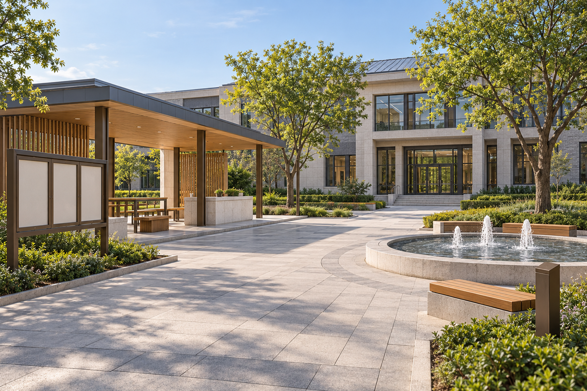
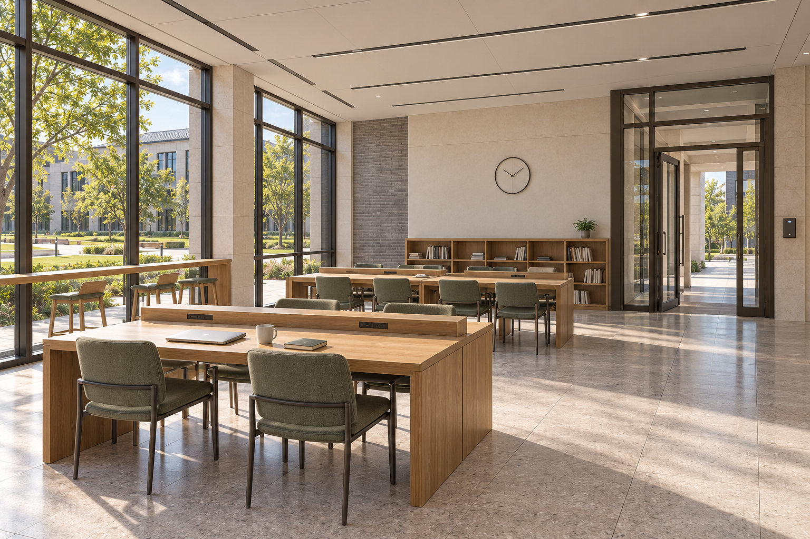

# A/B 共用风格样板 v1

这些图由项目负责人 Dallovers 统一提供，用于真实 3D 构建的风格参考。它们是 AI 生成图，不是当前运行程序的渲染截图。后续图片需求直接找负责人，队友无需配置生图工具。

## A：好友社交广场

## B：自习室

## 使用说明

- [统一材质、拟定尺寸与 A/B 构件说明](风格基准与AB建模说明.md)
- [完整生成提示词](完整生成提示词.md)
- [旧校园总览参考](校园总览_用户参考.png)
- [真实可运行的 3D 参考](../../../../examples/campus-3d-v5/README.md)

需要补图时说明：板块、对象、用途、视角、尺寸约束、沿用的构件。效果不理想时把源模型/源码和问题截图发给负责人，可以协助修改。材料统一、体量与布局允许因功能而不同。
