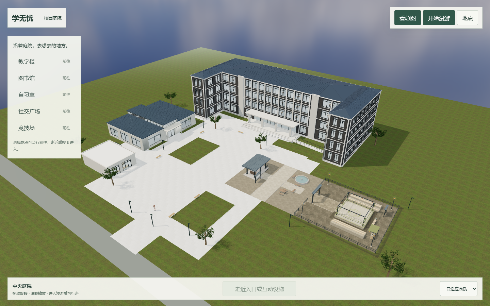
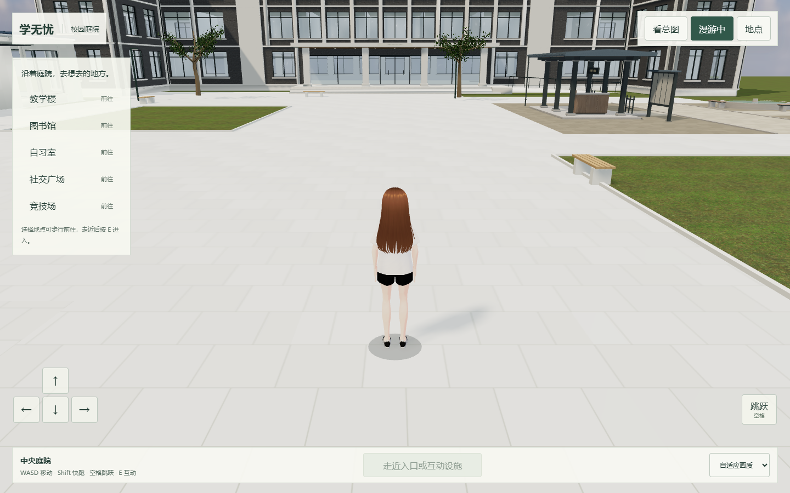
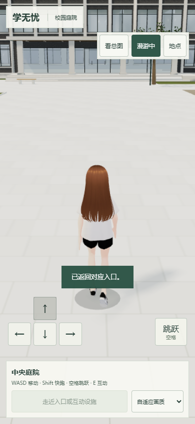

# 公共校园一期 · 真实运行验收

2026-10-22。图片均为当前整合代码的实际 WebGL 浏览器截图，非 AI 总图。AI 总图只作为 [排布参考](../campus-masterplan-v1/README.md)。采用原建筑模型，因此实际层数、占地和入口距离以运行版本为准。

`validation.json`：浏览器 38 项通过，包含实际行走到五处入口、各原场景就绪、返回门口和恢复朝向、五轮重复进出、真实原房间列表、输入暂停、iframe 无递归 3D 入口、实际触摸移动、BFCache 返回及 `/xuewuyou/` 子路径。

`static-boundaries.json`：7 项 HTTP 实测，确认必要校园页面/人物资源可访问，同时原 Blender 文件、模型作者工具、后端源码和图书馆烘焙源工程仍被拒绝。

`classroom.png / library.png / study.png / social.png / arena.png`：从公共校园进入对应原页面的实拍。

条件：Windows、本机 Edge、ANGLE D3D11 headless；桌面 1440×900，窄屏 390×844。没有把窄屏模拟或无头采样当作实体手机 FPS 保证。校园 API 的现有 8 项测试、导航/返回状态检查和 server check 也通过；未新增多人地图、重新烘焙整个校园或完成全站双账号业务复测。

启动方式与接入边界见 [宿主 README](../../../../js/features/campus-hub/README.md)。以上为本地集成结果，未上线。
