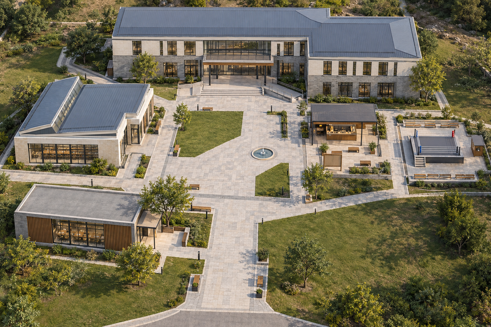

# 校园公共外场总图 · v1

日期：2026-10-22。

使用内置 image_gen 生成。图片为新生成的建筑鸟瞰规划参考，不是现有项目运行截图，也不是带精确尺寸的施工总平面。



## 方位与空间

本图以上方为北、右方为东。

| 位置 | 功能 | 设计意图 |
| --- | --- | --- |
| 上方 | 教学楼 / 现有教室 | 两层主建筑，门廊朝向中央庭院，台阶配缓坡 |
| 左侧 | C 图书馆 | 单层、抬高侧窗、蓝灰分段屋顶、大窗阅览立面 |
| 左下 | B 自习室 | 单层长条体量、暖木遮阳、通透玻璃 |
| 右侧中部 | A 社交广场 | 开放亭廊、服务台、无字留言板和坐凳 |
| 最右侧 | 竞技场 | 室外小型擂台、报名处、低看台，西侧接社交广场 |
| 中央 | 公共庭院 | 小水景、开阔铺装、两处草坪、步行环线与交叉捷径 |

## 用于后续制作的约束

- 按现有模型真实包围盒排布，图中建筑与入口不是对原模型的逐点复刻。中央庭院约 40×45 米是本次构图意向，最终尺寸由灰盒通行验证确定。
- 主步行路意向宽度 4—5 米。公共地面建立统一基准，门槛较高的建筑保留台阶与缓坡，不能简单平移模型后忽略碰撞和高度。
- 建筑保持不同体量，统一灰砖、浅色石材、深色金属框、暖木与自然日光；少量树木放在边缘，不遮挡主路。
- 先实现庭院走到五处入口、进入原场景、退出返回对应门口；外场负责保存返回位置与朝向，室内按需加载。
- 使用现有建筑、模型与已确认版本；本图不意味着 A/C 尚未合并 PR 已通过复审。竞技场模型与业务接法仍需独立联调。
- 生图未对真实模型重新烘焙。外场改变周围遮挡和日照后，受影响的原烘焙需重新核对或重烘焙。

## 实际生成提示词

```text
Use case: photorealistic-natural. Asset type: architectural campus masterplan aerial visualization for a real interactive 3D web campus, one landscape 3:2 image, high resolution. Draw a coherent, compact contemporary CHINESE UNIVERSITY campus as a convincingly built place photographed by a drone, not a toy diorama, illustration, fantasy campus or game concept painting. Main goal: clearly readable arrangement of FIVE functional areas around ONE central public courtyard, with distinct buildings and a continuous walkable path network. Camera from south looking north, steep approximately 65 degree downward aerial view at about 70 metres, north is the TOP of the image and east is the RIGHT. Entire planned site comfortably within the frame, minimal background beyond the site, no horizon, no cropped buildings. Natural real lens perspective, believable human-scale dimensions, photoreal architectural visualization, physically based materials, clean modeling-friendly massing, soft afternoon sunlight from upper left, neutral realistic saturation.

SITE LAYOUT MUST FOLLOW THIS EXACT ARRANGEMENT: The center is a roughly 40 by 45 metre open public courtyard, mostly pale stone paving with two modest lawns and ONE small circular shallow fountain only about 3 metres across, offset from the main walking axis. The courtyard is the connective heart, broad and open rather than planted over. NORTH/top: the main teaching building, the largest building in this compact campus, a restrained two-storey slightly L-shaped block approximately 45 metres wide, grey brick lower facade, light cream stone and light plaster upper facade, dark slim metal window frames, a broad transparent ground-floor entrance portico with warm wood soffit, a restrained blue-grey standing seam roof on part of the volume. Its main entrance faces south toward the courtyard; broad shallow steps and a clearly visible parallel accessible ramp reach its doorway. WEST/left: a distinct ONE-storey library approximately 25 by 18 metres, pale limestone, large dark-framed reading windows, a raised linear clerestory and two low blue-grey metal roof planes, east-facing glazed entrance directly onto the courtyard. SOUTHWEST/bottom left: a separate ONE-storey elongated self-study pavilion approximately 20 by 12 metres, warm timber sunshades, grey brick end walls, large clear glazing with faintly visible study desks, understated flat roof, northeast-facing entrance onto a small forecourt. Its shape must be different from the library and teaching building. EAST/right middle: an OPEN social plaza approximately 22 by 18 metres, a slim dark bronze STEEL PERGOLA with flat roof, warm wood underside, service counter, a freestanding blank cork message board and several wood benches; this is predominantly outdoor space, NOT another large enclosed building. FAR EAST/far right directly adjacent to the social plaza: a modest campus FRIENDS ARENA, a roughly 20 by 18 metre outdoor activity court containing a single human-scale 7.2 metre square raised boxing-style sparring platform, low stone base, four slender corner posts and three light ropes, an obvious entrance stair on its west side, a small timber registration counter at its east edge, only two LOW rows of seating on north and south edges. No stadium, no dome, no large grandstand. Its WEST entrance aligns with an unobstructed passage from the social plaza. Keep teaching building, library, self-study pavilion, open social plaza and outdoor arena separately identifiable, all present once.

CONNECTIVITY: a continuous 4-to-5-metre-wide pale stone pedestrian loop joins all five places; a broad central north-south promenade enters from the OPEN southern edge and reaches the teaching portico; east-west cross paths reach library and social plaza; a short clear branch reaches self-study pavilion; the social plaza flows directly into the arena's west entrance. All paths meet physically at ground level, no isolated disconnected paving islands, no dead-end lawns, no steps without alternate gentle ramps. All entrances and paths must remain visible from this camera angle. Buildings leave believable gaps for walking and small lawns. The principal courtyard surface defines datum; elevated door thresholds have clear shallow steps plus ramps. Avoid roads running through activity space. The shared material family is grey brick, pale limestone, light plaster, blue-grey metal roofing, charcoal or deep bronze frames, warm wood, honest clear glass. Shared family, but differentiated massing and roof silhouettes, not identical repeated buildings.

LANDSCAPE: ONLY about EIGHT well-spaced trees across the entire site, placed at peripheral resting pockets and the outer sides of buildings, with varied believable crown sizes and tree forms, mixed muted green foliage, grouped crowns rather than individually drawn leaves. At least 70 percent of the pedestrian courtyard and paths completely unobscured by tree canopies. A few low planting strips and small shrubs, realistic lawn and a few timber benches and slim dark bronze lamps. No forest, no tree grid, no continuous hedge walls, no balloon-sphere trees, no giant lawn voids. Gentle realistic terrain only at peripheral lawns, not a perfectly rectangular floating platform. Clean but naturally inhabited architectural atmosphere without people. No people, avatars, cars, text, labels, letters, numerals, arrows, compass graphics, map pins, logos, watermarks, interface, inset diagrams, decorative frame, campus perimeter wall or entrance gate. No Gothic, castle, pagoda, historical palace, cyberpunk, anime, watercolor, low-poly toy look, oversaturation. This is an aerial planning reference, not an exact screenshot from the existing program.
```
