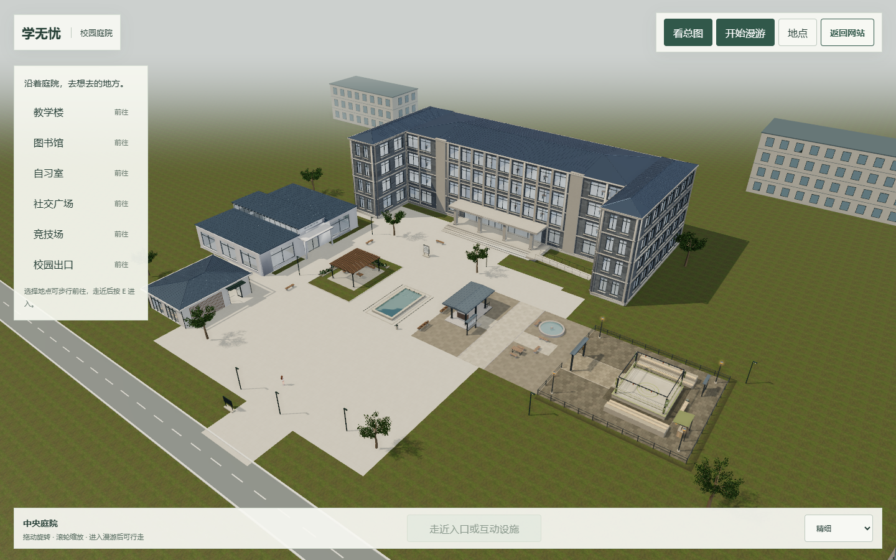
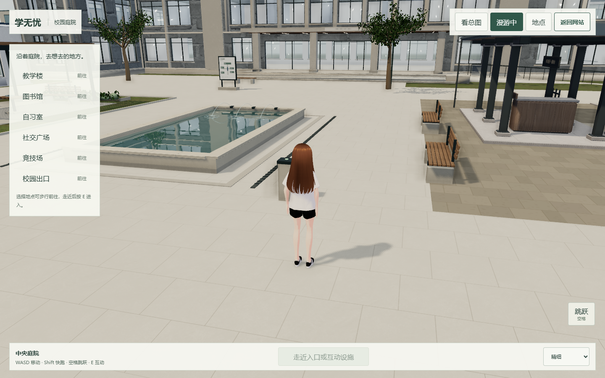
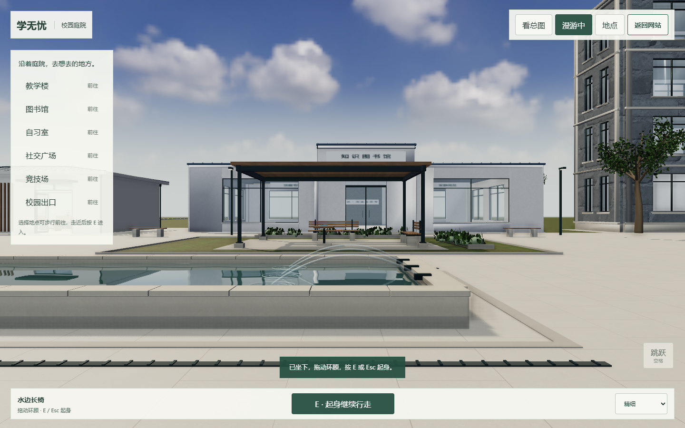
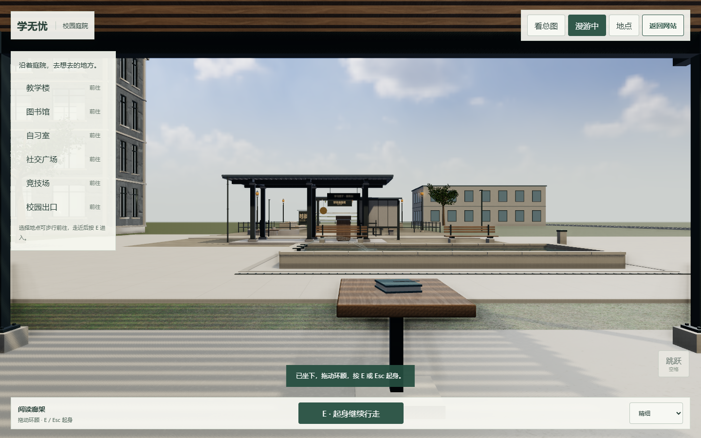

# 校园庭院写实渲染 v3

2026-10-23，本地分支 `integration/campus-hub-v1`。本目录为实际浏览器运行截图和验证记录；未推送或部署。本轮提高现有校园的材质、反射、阴影和远景表现，尚未达到整校照片级验收。

## 场景与材质

- 保留教学楼、图书馆、自习室、社交广场、竞技场五处入口及原页面往返机制。
- 按用户截图移除南侧 `(10,23)` 的长方形花坛、草地岛、边框与两张普通坐凳，原区域恢复为连续铺地。竞技场保留。
- 复用仓库原有扫描 PBR，原图片不覆盖、不从网络加载。石材采用风化混凝土扫描的低对比中性色近似，并非新扫描的石灰岩。灰砖与木纹使用米制局部投影，木纹沿板长；来源与 SHA-256 见 `surface-sources.json`。
- 水池加入限频建筑平面倒影；PC 自适应 384px，精细 768px，近处最多 10Hz，远处约 3Hz。流畅模式和手机关闭额外反射。
- 精细 PC 加半分辨率、12 样本 SSAO，主缓冲最多 4x MSAA。透明叶片、水面、天空与蒙皮人物不进入接触遮挡；人物使用渐变接地影。切回轻路径释放后处理缓冲。
- 漫游太阳阴影范围缩至 52m；HDR 天际线与雾色衔接。树木数量仍为八棵，增加已有树冠的叶簇密度；三个远景建筑组团仅作导航边界外的背景，没有新增入口。
- 仍使用同一渲染循环，沿原 pagehide / BFCache 生命周期释放并恢复场景；未新增物理引擎、实时点光源或多人系统。

## 实拍

1440×900、精细画质、本机 Edge / D3D11 headless。截图来自最终运行场景；没有用生成图替代 3D。

另附 `mobile-quality.png` 为 390×844 窄屏渲染，`quality-high.png` 为精细模式检查。

## 验证与边界

`capture.json` 记录截图页面状态与错误。`quality-validation.json` 为画质、缓冲释放、五轮画质切换、390px 和真实键盘移动的 8 项检查；`courtyard-validation.json` 为 15 项庭院互动检查；`campus-validation.json` 为 38 项原场景往返、布局、BFCache 与 Pages 子路径检查；`site-exit-validation.json` 为 6 项网站出口检查。导航单元检查与构建另行执行。

帧间隔为本机单核亲和运行的无头浏览器样本，不能作为实体手机帧率承诺。测试运行使用 D 盘官方签名 Node 22 二进制，并仅对测试进程设置 CPU 亲和，规避本机 libuv 计时断言；未修改系统配置，二进制未纳入 Git。

整体 GI、建筑内部反射、远景外墙和植被仍有近似；没有全校园重新烘焙。原二次元人物按用户选择保留。精细模式有额外渲染成本，窄屏默认使用轻路径。实拍与报告只证明本地版本，未验收线上或所有实体设备。
