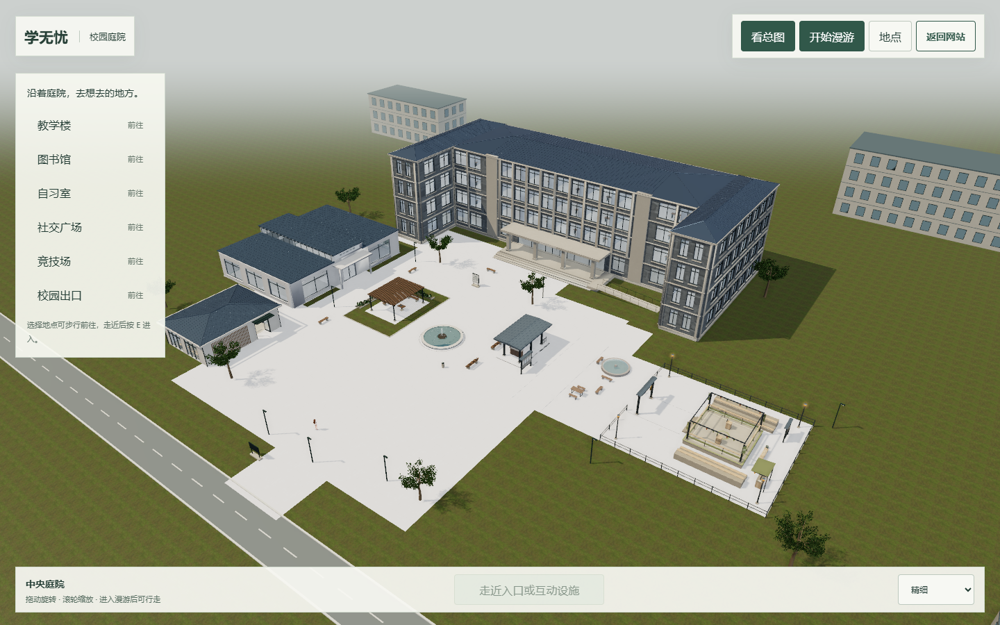
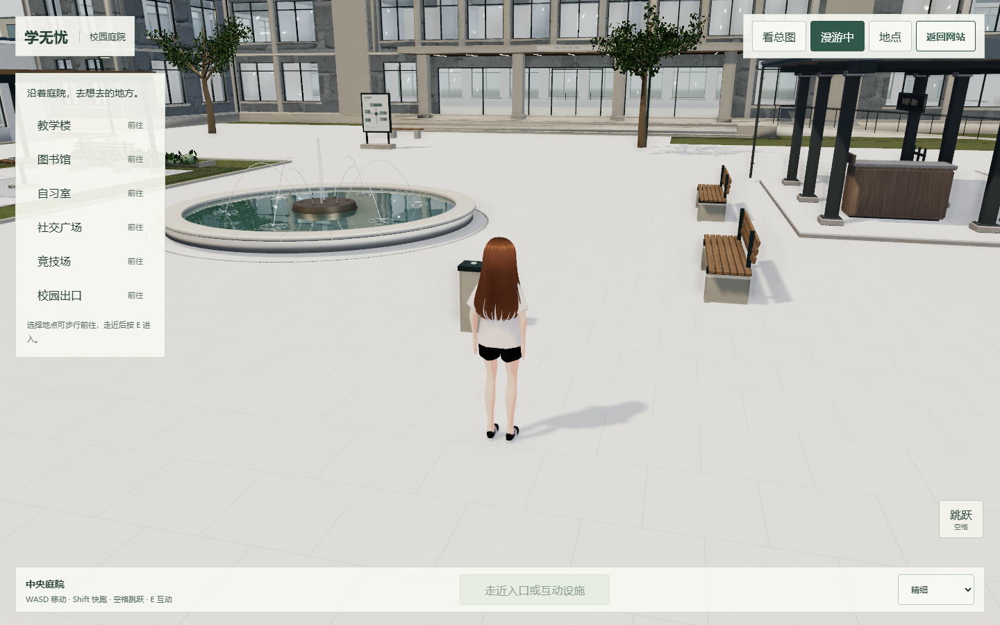
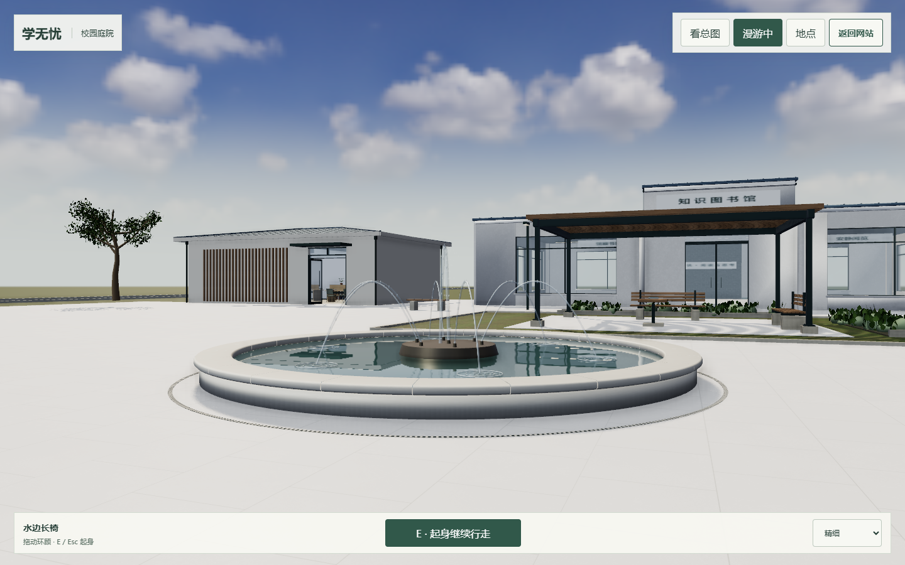
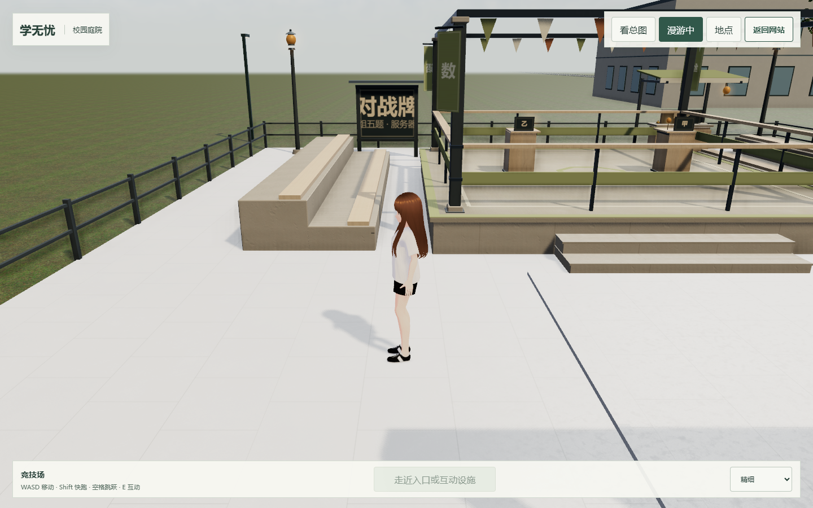
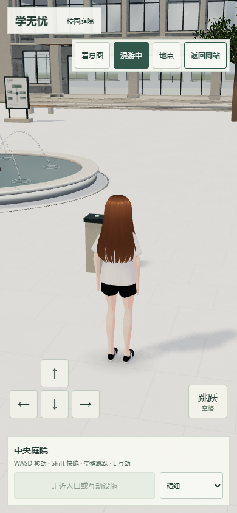

# 竞技场同步、浅白铺地与圆形喷泉

2026-10-23，本地 `integration/campus-hub-v1`，基线 `05549f5`。未推送、远端合并或部署。

## 来源与范围

竞技场同步 [PR #89](https://github.com/Dallovers/xuewuyou/pull/89) 的固定合并版本 `3b2756023e6e5819c5e02fb33acd883ee365d539`（PR head `14403eeec95629bd1bc293c4f418ab969b43277b`），包括该版本中 #83—#87 的前置更新。同步 `js/features/arena/{arena-district.js,index.html,preview.html,arena.css,README.md}`，没有整树覆盖其他成员文件。远端 Git 直连失败后，使用 GitHub 连接器按固定 SHA 读取文件。

本地额外保留 `sharedSite` 宿主适配，竞技场自己的草地、远景和浮尘不在公共宿主重建；恢复 `return-bridge.js`，修正北侧答题台牌面朝向，使甲乙牌均面向西侧入口。新版纸条接入公共宿主的纯文本面板、输入暂停、Esc 与拾取禁用状态。

室外公共地面、社交广场及竞技场铺地复用一个宿主持有的浅白石材材质，800mm 板缝通过世界坐标连续投影。只在 district.ready 后替换选定铺装网格，避免异步贴图回写；独立页和建筑室内地面不随宿主改色。草地、木构、答题台及建筑外墙各保留材质分区。

圆形喷泉位于 `(-0.6,5.5)`，外半径 3.14m、水面半径 2.75m。低矮白石池沿、24 块弧形压顶、缎面青铜底座与喷嘴、溢流细边、齐平环形排水槽，中央细喷加六道环形水弧。圆形反射水面使用原限频与画质降级；84 个水滴、64 个细喷点共用原 20Hz 更新，无新 RAF。池东侧到长椅净距约 4.3m。

圆池的圆形碰撞与寻路共用同一判定，外包盒只供相机避让。原来的南侧长方形花坛仍移除。五个原场景入口、网站出口和原业务保持。

## 设计参考与实景

`fountain-design-reference.png` 是本轮通过 imagegen 生成的建筑设计参考，提示为低矮浅白石圆池、深青铜细节、中心细喷和六道水弧。它不进入运行时，也不代表真实 3D 的完成度。

以下为最终本地应用的实际浏览器截图：

`fountain.png` 与 `arena.png` 拍摄时临时隐藏侧栏、移动控件与提示条，模型和精细画质参数与实际应用一致。

## 验证

构建、导航单元检查（含圆池边角与绕行），以及原 8 项画质、15 项庭院互动、38 项场景往返、6 项网站出口回归通过。本轮专项 11 项通过，合计 78 项浏览器检查。`round-validation.json` 为本轮专项；`campus-validation.json`、`courtyard-validation.json`、`quality-validation.json`、`site-exit-validation.json` 为最终回归原始报告。

采用本机 Edge / D3D11 无头浏览器，390px 为窄屏模拟；未作实体手机性能保证。额外水粒子有渲染成本，手机保留轻反射路径。整体建筑、树木、GI 与水流仍有近似，未宣称整校照片级；没有增加登台对打、选手 NPC 或新的答题后端。
