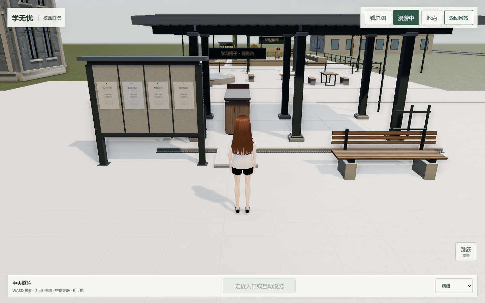
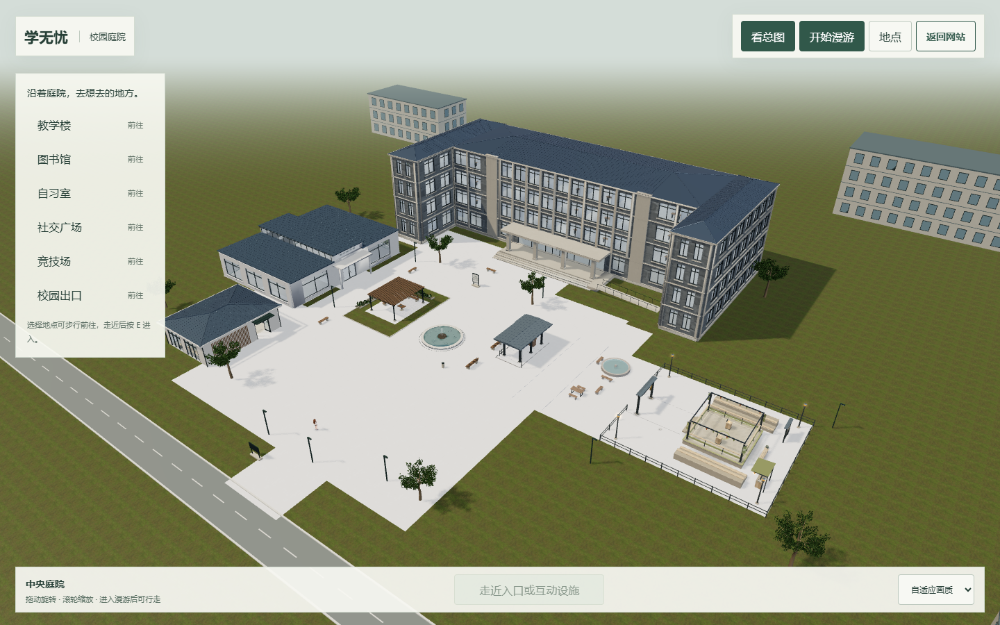

# 服务台与留言板面向中央庭院

2026-10-23，本地 `integration/campus-hub-v1`，基线 `0804785`。

公共宿主绕亭廊中心 `(10.8,1)` 原地旋转亭廊、学习搭子服务台、留言板及配套固定件 180°，使服务正面朝西、面向中央庭院。柜门、灯带、招牌、四栏留言文字、板脚与锚栓、屋面、台阶和排水随同旋转。服务台实际互动中心为 `(10.8,-0.65)`，留言板为 `(7.8,-2.6)`。

碰撞中心在 district 转为世界碰撞前同步旋转；互动保持原对象引用，动态读取完整父节点矩阵。实例化构件整体跟随父组，不拆散。白石铺装仍按世界坐标投影；原 AO/GI 在公共宿主保持禁用。社交广场其他设施、竞技场与原独立预览采用原布局。

`src/social-placement.js` 集中本地宿主摆放，未改 A 的场景源文件或业务实现。五处原场景入口和返回站位保持。

截图来自实际 Edge / D3D11 headless；正面图拍摄时临时隐藏侧栏和提示条。`social-validation.json` 验证朝向、互动中心、旧碰撞清理、真实 W 行走后 E 打开原好友/留言页签、面板暂停和关闭恢复；`campus-validation.json` 为五场景往返、390px、五轮进出、BFCache 和 Pages 子路径回归。未验双账号新业务或实体手机性能。

修改仅在 D 盘本地工作树，未推送或部署。
