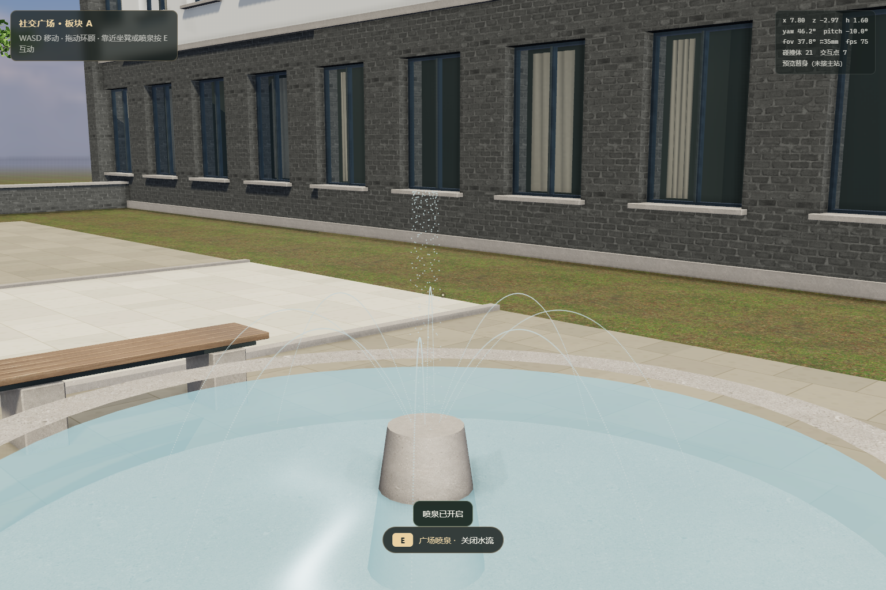

# 社交广场：坐凳与喷泉互动

复用视觉PR43的c0b4477，不重建广场。本批只有三张坐凳和喷泉设施互动；好友、留言、竞技仍沿用原业务契约，预览没有重新实现账号或请求。未修改D公共宿主，不合并部署。

## 体验

仓库根目录运行`python -m http.server 8099`，访问`/js/features/social/preview.html?x=0&z=-5&yaw=-90&pitch=-10&mm=35`。WASD移动，鼠标拖动环顾；走近坐凳按E坐下，E、Esc或“起身”按钮回到原来经过碰撞校验的站位。坐下眼高1.18m，站立1.6m，.32秒过渡，坐下暂停移动。

喷泉位于(5.6,-5)，走近按E开启/关闭，提示即时更新，长按不会重复切换。水面微波纹、8道弧形水流及中央水柱由2048粒子和256条水纹线段绘制。两个额外绘制对象、64×64自产点精灵；不增加实时灯、影子或外部资产。水流为装饰近似，没有物理折射、流体碰撞、声音或联机共享开关。

[关闭对照](fountain-off.png) · [实际坐下视角](bench-seated.png)

## 给D的增量契约

createDistrict的root/colliders/interactions/ready/update(dt)/dispose()不变。旧social.desk/board/challenge参数、object和radius保持原样；坐凳和喷泉不新增静态碰撞，不改变三条业务路由。

- 新增social.bench.1/.2/.3，object为既有坐凳Group，radius=1.25，kind='seat'。action返回`{ok:true,kind:'seat',id,label,position:[x,y,z],directions:[[dx,dy,dz],...]}`；position是经object.matrixWorld转换的世界坐姿眼位，directions为两侧朝向。卸载后action返回`{ok:false,reason:'disposed'}`。这是位姿数据，不直接修改公共相机。
- 三凳位置分别(3.1,-5)、(5.9,-1.9)、(6.3,.9)，原实体、座高.45m和碰撞均保留。宿主选择接近侧朝向、保存已验证站位、暂停移动并处理起身；preview-activities.js仅是独立预览适配，不能导入主站替换公共移动/输入。
- social.fountain仍返回`{ok:true,kind:'fountain',on,message}`，radius=3，object和坐标不变；现在action产生实际水流，prompt随开关变化。由已有district.update驱动，无新增RAF或renderer。默认关闭；dispose释放Points/LineSegments几何、材质、点精灵和水面材质，重复调用幂等，卸载后update/action不回写。
- preview.html仅增加适配器调用、坐姿输入门控和设施即时反馈，CSS新增在社交模块内；D公共宿主未动。触屏移动与统一设施按钮仍由D负责，现有桌面预览只额外提供起身按钮。

## 烘焙与验证

本次没有增加、移动任何静态Mesh。水流为透明Points/LineSegments，不作为静态AO/GI遮挡体；水面只改反射/微法线。未修改任何签名校验。用现有导出器重新导出，165目标构件、全部不透明遮挡几何/平均材质数据与v4压缩源逐项相等，sceneSignature仍c8e35586；烘焙无需重做。运行AO/GI实际加载成功。绑定后UV展开会改变内存几何签名，因此测试对绑定前模型核对manifest，并验证开关前后签名一致。

已运行：npm run check --prefix server（34前端语法、412 id引用）；新增JS语法；activities.cjs、three-points.cjs、visual-regression.cjs及git diff --check。

- [活动原始验证](validation.json)：三张坐凳均W实走后E触发；坐下禁止W移动但可环顾；E/Esc/按钮起身回原站位。喷水可见、粒子位置随update变化、长按E不重复切换、关闭再开通过。无pageerror或console error。
- 开水后五轮全可见渲染/重复dispose，geometries/textures稳定489/60→243/33，已释放action拒绝。计数包含仍挂载预览，不是单模块总量。
- [业务入口回归](three-points.json)：实走E触发friends/posts/arena参数未变，桌体碰撞与三轮释放通过。
- [视觉/生命周期回归](visual-regression.json)：原UV/连接/通路/碰撞、晚到PBR/AO/GI、共享资源、五轮释放和后处理释放通过。没有用直接action调用代替互动可达性。
- 设备TX Gaming FX608LPG、Ultra7 251HX、约32GB、Windows11、Intel Graphics0x7D67 ANGLE D3D11、Chromium156.0.8078.4；1536×1024 DPR1、35mm、曝光.86。截图显示HUD用于验证状态。无头实际移动的帧间隔见JSON，只作回归记录，不代表实体显示器FPS或手机性能。

没有新增AI图片/第三方素材，既有授权记录保留。整体视觉仍有远景、植物透射和材质微结构差距，本批不宣称照片级。未验收主站公共宿主、两个真实账号同步行为或移动端完整操作。
