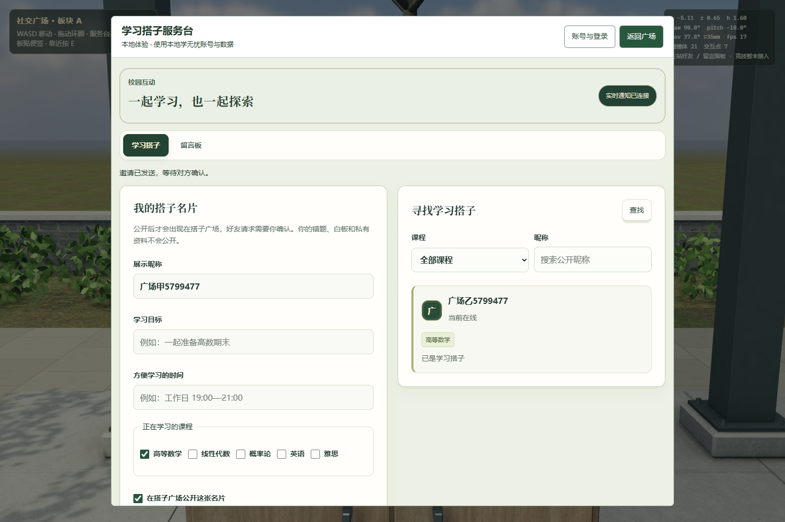
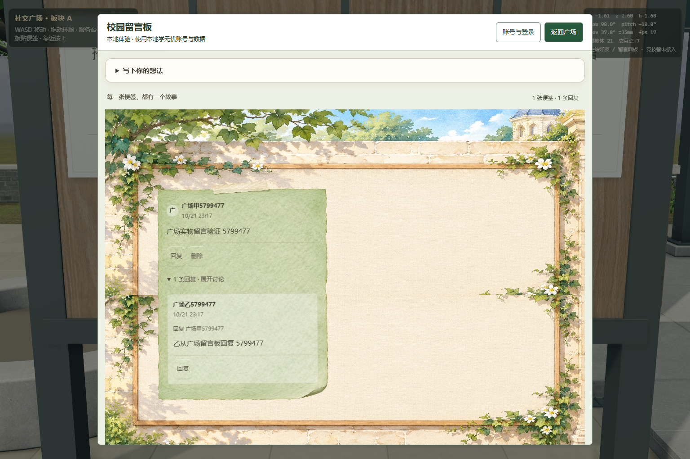

# 社交广场：接入原主站学习搭子与留言

2026-10-21，`feature/social-community-preview`。本笔基于 PR54 活动场景，已合 main `8731843`（包括自习室 PR57/58），没有覆盖 D 的接入分支。用户明确竞技先不接：竞技桌保留可达实体，预览E只给暂未接提示；本轮无竞技业务 iframe 或 challenge 请求。

## 运行

Node>=22.12，仓库根目录 `npm ci --prefix server` 后 `node server/scripts/social-preview-dev.cjs`。打开 `http://127.0.0.1:8099/js/features/social/preview.html?x=-5.2&z=.65&yaw=90&pitch=-10&mm=35`，靠近服务台/留言板按E。原旧体验 URL `/previews/social-visual-v4/index.html` 同样直接提供当前源代码。WASD行走、拖动环顾，面板内输入不移动；“返回广场”或Esc关闭后继续行走。账号入口使用原主站注册/登录，而不是预览自建登录。

**该启动脚本使用隔离本地账号和数据，不连接线上账号库。** 本地注册账号可跨页/刷新恢复；原主站 UI、WG_API、Node社区后端、Socket.IO均真实运行。本地 `deploy-config` 覆盖仅存在内存路由，不改生产配置。`DATA_DIR` 建议D盘，默认被git忽略。详细参数/返回及D待接事项见 [一页交接](../../social-community-preview-handoff.md)。

## 实际程序证据

以下均为程序实际截图，非概念图或生成图。桌面1536×1024、DPR1；机位来自W实走服务台/留言板，35mm、站姿1.6m、曝光.86。保留HUD证明实际站位和状态。本笔没有视觉几何改动，不作为新一轮照片级前后对照。

[390×844布局截图](posts-mobile-layout.png) 仅验证面板布局，不代表触屏移动已接入。

## 验证结果

- `npm run check --prefix server`：前端34文件语法、412个id引用及仓库后端语法检查通过；新增脚本单独 `node --check` 与 `git diff --check` 通过。
- `tests/community-preview.cjs`：[原始报告](validation.json)。两个独立浏览器/真实后端隔离库，实走W/E，原UI注册/公开名片、邀请与接受、双边好友列表；发布、实时可见、回复、作者删除/保留回复均通过。零pageerror，报告只记录请求方法/路径，不含token/密码。
- 同脚本：输入W/E不移动，Esc/按钮恢复行走；连续5次关面板iframe数量0；503主站文档卸载并重试成功；原登录Esc优先、登录返回posts、页面刷新保持账号通过。实走竞技桌，未创建业务iframe、未发challenge请求。
- `tests/three-points.cjs`：[本轮回归](interaction-regression.json)。当前明确只验证friends/posts实际调用，竞技另由上项断言禁用；桌碰撞停x=3.0；三轮全网格渲染/重复dispose的geometries/textures稳定475/58→231/32。计数含仍挂载的预览场景。
- `tests/activities.cjs`：[坐凳/喷泉回归](activities-regression.json)。三凳实走、坐/起身/环顾，喷水动态与开关、长按E、五轮dispose及旧action拒绝通过；489/60→243/33每轮稳定。
- 仓库 `server/scripts/community-friend-e2e.js http://127.0.0.1:8099`：隔离本地后端16/16通过，含双账号邀请/接受、留言持久化、删除权限及未登录401。该脚本是HTTP检查，不代替上面的双浏览器实走。

设备沿用本机 TX Gaming FX608LPG、Ultra7 251HX、约32GB、Windows11、Intel Graphics ANGLE D3D11；Chromium156.0.8078.4无头。上列有实际键盘移动；不把无头帧率当用户设备表现，本轮不声称性能提升。后端未改规则，没有为本笔重新执行无关全量业务测试。

## 变更与限制

新增3个预览适配JS/CSS文件、1个本地开发服务脚本、1个双浏览器验证脚本；preview.html 最小增加模块/输入门控，原业务与公共宿主不改。iframe移除及回调失效验证完成，未做浏览器堆快照/长时网络泄漏测试。静态模型、纹理、UV、碰撞、烘焙完全沿用，无新增第三方或AI素材、无资源授权变化。

尚未验收线上账号、生产部署、公共宿主完整流程、真实触屏和邀请拒绝的双浏览器流程。好友/留言现在是独立预览中的真实主站功能，不等于D公共宿主已经接入。竞技暂缓，无同步竞技完成声明。整体视觉的远景、植被透射和材质微结构差距仍在，不宣称照片级。无自行合并或部署。
