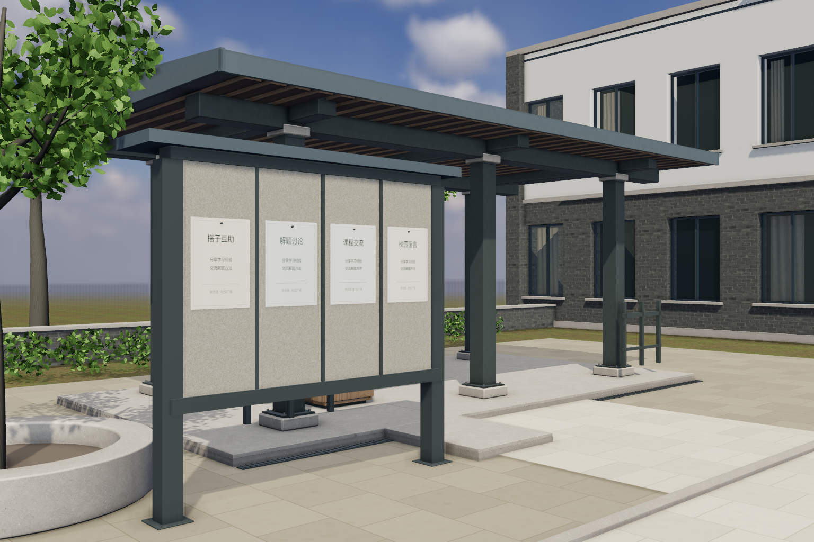

# 社交广场：近景构造与材质 v5

2026-10-22。基于 PR61 的 `b500fdc3bc28823d2982584c751b9357152ae942`，独立分支 `feature/social-nearfield-v5`；合入 main `b5973fb`（含PR65/67/68），自习室更新原样保留。本批模型代码 `96c6384`，仅近景模型/材质，不改主站社区、后端规则或D宿主。用户要求竞技暂缓，本轮继续遵守。

## 从实际画面确定的问题

基线截图中最突出的是：①服务台整块实体箱体、门缝后仍是木块；②柜门、侧板和坐凳共享相同UV起点，重复木纹明显；③留言板与柜体同木纹，坐凳/梁端/板脚缺少可读的固定关系。背景空旷、树冠与透射仍有差距，但没有借本批扩建校园。

新 `social-nearfield.js` 将服务台换成22mm板件组成的五板空心柜壳。外包1.76×1.01×.65m不变，保留原门、把手、石台面、踢脚和交互mesh。门/侧板/坐面UV只平移，保留米制尺度、法线与倒角，不改用整张渲染图冒充立体。

新增24个坐凳齐平固定件、24套梁端垫圈/六角头，以及留言板2块240×240×18mm底板、8个锚栓。重复小件实例化，不增实时灯，小件不投射实时阴影。2个底脚box随模型更新，主路与服务台/留言板东侧可站位置保留。尺寸及给D说明见 [最小交接](D-HANDOFF.md)。

留言板改为低对比软木表面，石材用独立线性微孔height/roughness，停止用albedo污纹充当高度。米制UV石材面每.12m重复、bumpScale=.00007m；软木bumpScale=.0003m。新增4张程序纹理，不是实测扫描PBR，不含新AI或第三方图片；原 [PBR来源](../../../../js/features/social/assets/pbr/sources.json)、[既有生成素材provenance](../../../../js/features/social/assets/generated/provenance.json) 及 [复用CC0材质来源](../../../../examples/campus-3d-v5/assets/sources.json) 保留。

## 同条件实际对照

1536×1024、DPR1、视高1.6m、35mm、曝光.86、HUD隐藏。日光、HDR、SSAO等配置保持不变；before由Git完整 `b500fdc` 树运行，after为本批代码/新烘焙。不是只替换模型后借用旧光照，也没有提高曝光制造差异。

| 视角 | 修改前实际截图 | 修改后实际截图 |
|---|---|---|
| A1：-3.8,-1.2 /118.6°/-11° | [before-A1](before-A1.png) | [after-A1](after-A1.png) |
| A2：.5,6 /47.7°/0° | [before-A2](before-A2.png) | [after-A2](after-A2.png) |
| A3：-7.2,6.2 /0°/0° | [before-A3](before-A3.png) | [after-A3](after-A3.png) |
| 广场全景 | [before](before-panorama.png) | [after](after-panorama.png) |
| 服务台近景 | [before](before-desk.png) | [after](after-desk.png) |
| 柱脚与铺装 | [before](before-foot.png) | [after](after-foot.png) |
| 坐凳固定件 | [before](before-bench.png) | [after](after-bench.png) |

## 烘焙和资源

几何确有变化，旧c8e35586图集不兼容。使用现有运行模型导出器重新导出精确目标与全部静态不透明遮挡，Blender4.5.3 Cycles重烘焙165构件AO/低频间接光；2048图集、AO32样本/.6m/8px、GI64样本/4次漫反射反弹。新签名bcfeaace，不修改校验逻辑；图像SHA256随manifest更新。透明窗、枝叶/草及材质细纹未参与完整离线路径追踪，仍属原近似。

[压缩精确源](baking/source.json.gz) · [烘焙脚本](baking/bake_light.py) · [日志](baking/bake.log) · [图集大小/哈希变化](resource-changes.json)。导出仍用 `docs/team/visuals/social-pavilion-v4/baking/export-source.cjs`，通过 `SOCIAL_BAKE_SOURCE` 指向D盘输出；Blender命令与v4相同，仅换成本目录脚本/新源/目标目录。不能只复制新签名。

## 验证与实际入口

- `npm run check --prefix server`：34前端文件语法、412 id引用及仓库检查通过；新增JS语法、`git diff --check`通过。
- `tests/nearfield-v5.cjs`：[修改前报告](before-validation.json)、[修改后报告](after-validation.json)。三机位/全景/构造实拍，165构件实际AO/GI绑定、图像哈希、空心柜体射线/22mm板厚、米制倒角UV仅平移、底脚碰撞包络、宿主材质/纹理所有权及五轮全网格渲染/重复dispose通过。计数含仍挂载预览，不当作独立模块总量。
- `tests/activities.cjs`：[本轮坐凳/喷泉回归](activities-validation.json)。实际键盘行走、坐/起身/环顾、喷水开关和动态、长按去重、五轮dispose与卸载后action拒绝。
- `tests/community-preview.cjs`：[本轮双浏览器回归](community-validation.json)。两个独立浏览器真实隔离后端，实走W/E、原UI好友邀请/接受/双边更新、留言发布/回复/删除、关闭恢复/登录刷新/失败重试/晚到文档与竞技禁用。

单次主场景渲染的A2从190 calls/166460 triangles到195/168644；全景245/167556到251/170892。五轮全网格加载/卸载486/63→236/33（geometries/textures）稳定；开水场景498/66→246/35稳定。新固定件增加成本，不声称本轮性能提升。报告含其他机位、memory及活动实际移动采样；CPU/显卡沿用本机TX Gaming FX608LPG、Ultra7 251HX、约32GB、Windows11、Intel Graphics ANGLE D3D11；Chromium156.0.8078.4 headless，1536×1024 DPR1。这些无头帧时不是用户显示器/手机FPS。

仓库根目录 `npm ci --prefix server` 后 `node server/scripts/social-preview-dev.cjs`；打开 `http://127.0.0.1:8099/previews/social-visual-v4/index.html?x=.5&z=6&yaw=47.7&pitch=0&mm=35&v=nearfield5`。WASD行走、拖动环顾，服务台/留言板按E打开原业务；坐凳/喷泉按E互动。使用隔离本地账号/数据，线上账号不同步，首次通过原“账号与登录”注册本地账号。

整体仍未达到照片级：远景体量与地平线空旷、树叶透射/枝梢轮廓、程序软木与微孔的实测可信度、有限低频GI仍有差距。本批未新增开关柜门动画、流体/声音、无障碍坡道或校园扩建；未验线上、D公共宿主完整流程、真实手机或长时堆内存。竞技不接入；不自行合并或部署。
