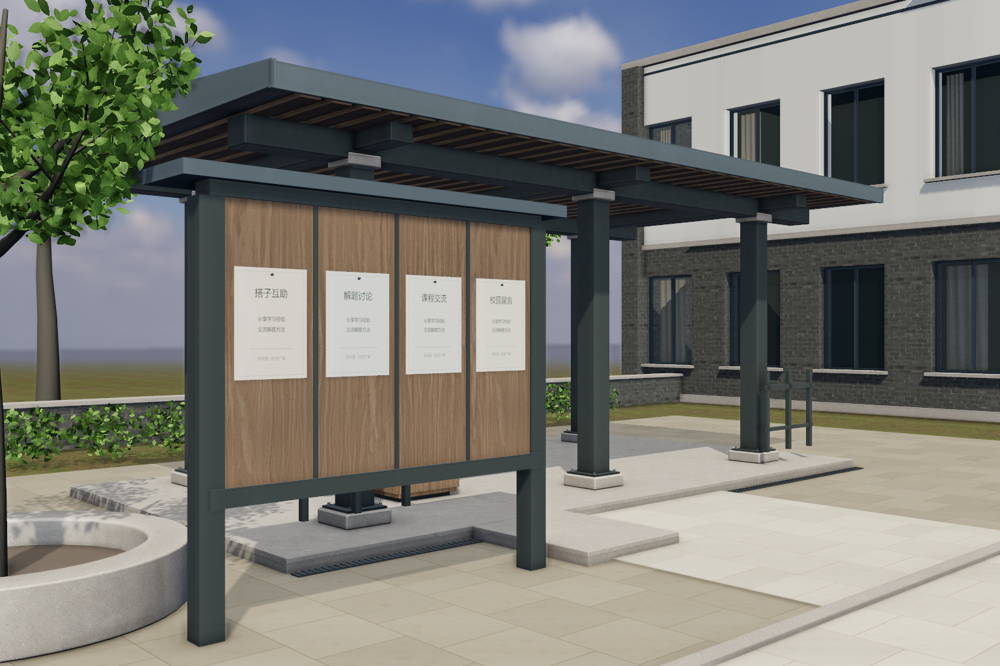

# 社交广场视觉补充 v4：实拍、构造与集成交接

本轮已实现并运行验证，尚未通过“照片级整体效果”的最终验收。近景增加了真实连接、板件和接触细节；远景、植物透射及程序微表面仍能看出实时近似。本文截图全部是本项目 WebGL 实拍，没有生成场景图或后期修图。

代码提交：`ca7c9c4bc2d1ee8313073f965b583dfc20f92801`。独立工作分支 `feature/social-visual-detail-v4`，交付到原视觉 PR43 的 `feature/social-visual-pavilion-v2`，不合并 main、不部署。main 核对为 `b625413ac1f5eee07011590e2a3c9025ee81191d`。从 PR43 的 `433ab8c` 建立工作树，合入 PR45 三交互点 `3cdd46f`，解决导入冲突时保留双方模块；没有操作其他工作树或 D 的接入分支。PR47 同步竞技业务仍是独立交付，本轮不修改主站 `js/community.js` 或 `server/community`。

## 运行入口和实拍

仓库根目录运行 `python -m http.server 8099`，进入：

`http://localhost:8099/js/features/social/preview.html?x=.5&z=6&yaw=47.7&pitch=0&mm=35&hud=0`

WASD 移动，拖动视角，E 触发，Esc 关闭说明。预览说明面板不是主站完整业务流程。

全部对照保持 1536×1024、DPR1、人眼高1.6m、35mm、曝光0.86、HUD隐藏；日光3.2、半球光.24、补光.08，同一HDR和雾参数，没有用曝光洗白。三个固定机位：

| 机位 | x / z | yaw / pitch | 改前 | 改后 | 最终（SSAO开启） |
|---|---|---|---|---|---|
| A1 服务台近景 | -3.8 / -1.2 | 118.6 / -11 | [before-A1](before-A1.png) | [after-A1](after-A1.png) | [final-A1](final-A1.png) |
| A2 亭廊与留言板 | .5 / 6 | 47.7 / 0 | [before-A2](before-A2.png) | [after-A2](after-A2.png) | [final-A2](final-A2.png) |
| A3 亭廊正面 | -7.2 / 6.2 | 0 / 0 | [before-A3](before-A3.png) | [after-A3](after-A3.png) | [final-A3](final-A3.png) |
| 全景 | 0 / 16 | 0 / -5 | [before-panorama](before-panorama.png) | [after-panorama](after-panorama.png) | [final-panorama](final-panorama.png) |



[柱脚构造近景](detail-column-foot.png)、[竞技桌分板近景](detail-challenge-table.png)均保持眼高1.6m；具体机位见[detail-views.json](detail-views.json)。[final-eye.png](final-eye.png)为留言板纸面近景；[roof-cutaway.png](roof-cutaway.png) 为高4.3m、暂隐屋皮的构造检查图，不能当人眼完成效果。

改前使用 `3378257e9f96c8acf498903c4c395ed75cde23c7` 的完整模块与资源，即原 v3 视觉加 PR45 竞技桌/留言板布局；几何变化使当时旧烘焙按规则拒绝，因此改前没有烘焙绑定。改后使用本轮精确模型重新烘焙；这是实际集成前后的差异，没有绕过签名。before/after 均关闭屏幕空间 AO，final 单列开启。原433版未增加竞技桌的有效烘焙实拍保留在 [v3历史证据](../social-pavilion-v3/README.md)，不与本轮布局混称同一基线。

## 从实际画面确定的三个问题

1. 服务台前景的构造薄弱：柱脚板原先落在石座底部、柜门缺五金、灯条偏装饰性。先纠正承托关系，再加近景连接细节。
2. 背景窗洞虽有进深但后方是平面，原三层层高偏矮。改成两层可信层高，补真实浅室内，控制玻璃亮度。
3. 西侧一眼看到空地平线，枝条呈直杆放射。只在通路外补三棵疏密不同的背景树和低景墙，改弯曲渐细枝条，没有扩建校园。

## 已实现的几何与材质

- 亭廊六柱：420×120×420mm石座，360×18×360mm底板，220mm柱；石座顶+.240m→底板顶+.258m→柱身，保持屋面原标高。24组M16外形锚栓和垫圈、12块梁端连接板均为几何。石座碰撞由360mm改为440mm，包含倒角边缘。
- 服务台保留原尺寸和入口，增加两扇门实际拉手和短固定件；乳白灯罩落在深色槽内，取消琥珀色脉冲，未增加实时灯。
- 西檐增加正厚度檐沟、落水管和管箍，落水管在 x=-9.51、z=-4.73；新增相应碰撞盒。台基东侧增加齐平排水槽及150格栅条（一次实例化绘制）。排水构件未模拟水力。
- 竞技桌保持1.70×.80m、桌高.75m、40mm桌板；六块倒角木板与4mm缝。座高.45m、35mm坐面板。已有坐凳承托、倒角米制UV及通行尺寸保留；未做大型竞技场。
- 留言板四张有轻微卷曲的永久说明纸与图钉；内容是学习交流用途，不伪造用户帖子、在线人数或留言记录。真实帖子仍由主站面板提供。
- 原30m背景立面变为两层3.65m层高，26个1.4×2.1m窗洞，增加窗框/密封条/窗台/滴水边。窗后用真实地面、顶面、背墙、局部隔墙和褶皱窗帘；不使用室内照片。背景模型碰撞包含新深度，仍在可行走广场外；这是可替换背景，不是可进入教学楼。
- 树干和枝条使用弯曲渐细体积几何；近树每棵3600片曲面叶，西侧三棵各1900片并变化种子/大小。新增背景树不投射实时阴影；未增灯。
- 铺装颜色/凹凸/粗糙度板缝同源，移除不对应板缝的旧混凝土法线借用。树皮、涂装微表面为确定性程序贴图；木、砖、石材保持已有来源和尺度。不是实测扫描完整PBR。

## 烘焙与缓存修复

从本版精确运行几何重新输出165构件、5154目标三角形，Blender4.5.3 LTS Cycles CPU：2048图集、AO32样本/.6m/8px边距；DIFFUSE INDIRECT64样本/4次漫反射反弹。运行绑定uv1、AO强度.4、间接图lightMapIntensity=π；直接光仍由WebGL计算。

低频GI使用平均表面色；薄玻璃和透明叶片/草不作离线遮挡，没有完整透射/折射，阴影树叶仍由实时影子处理。这是本场景的受限烘焙，不能称完整材质路径追踪。

保留整场景及每构件几何签名校验。另修复图集缓存：manifest要求重新验证，图集URL带实际图像哈希，避免新UV配旧缓存。烘焙脚本使用绝对输出目录，检查文件实际写入时间和SHA256；视觉脚本在启动浏览器前核对两张实际图像哈希。最终sceneSignature为 `c8e35586`。封装导出器已重新执行并与烘焙输入逐项一致。

复现输入与脚本见 [baking](baking/)：`source.json.gz`、`export-source.cjs`、`bake_light.py`、`bake.log`。解压输入并使用本机Blender执行，例如从仓库根目录：

```powershell
python -c "import gzip,pathlib; p=pathlib.Path('work/social-v4-light-source.json'); p.parent.mkdir(exist_ok=True); p.write_bytes(gzip.decompress(pathlib.Path('docs/team/visuals/social-pavilion-v4/baking/source.json.gz').read_bytes()))"
$atlasOutput=(Resolve-Path js/features/social/assets/baked).Path
& $env:BLENDER_EXE --background --factory-startup --python docs/team/visuals/social-pavilion-v4/baking/bake_light.py -- --source work/social-v4-light-source.json --output $atlasOutput --hdr examples/campus-3d-v5/assets/sky.hdr
```

改几何后应先重新运行导出器（外部Playwright依赖、`SOCIAL_BROWSER_PATH`、`SOCIAL_CDN_CACHE`，可用`SOCIAL_BAKE_SOURCE`指定D盘输出），不能复用旧快照或只改签名。

## 素材授权与资源变化

本批没有生成AI图片，没有下载新第三方素材。沿用 [v3素材记录](../social-pavilion-v3/README.md)、[既有生成贴图完整来源](../../../../js/features/social/assets/generated/provenance.json) 和仓库原有木/砖/草/HDR许可；已有生成贴图不冒称CC0或扫描照片。本轮程序纹理和几何为项目自产。既有Three.js许可证保留。

相对3378257，AO PNG 1,931,867→2,387,469字节，GI JPEG 1,015,958→972,984字节，manifest 240,593→315,895字节，运行烘焙资源净增487,930字节。没有新增下载纹理；程序画布增加GPU纹理开销。完整字节/哈希见 [provenance.json](provenance.json)。审查截图与压缩烘焙输入仅用于文档，不在运行时加载。

## 验证结果与性能边界

- `npm run check --prefix server`通过：34个前端文件语法、412个id引用。相关场景、测试、导出JS语法及烘焙Python解析通过，`git diff --check`通过。本批无后端修改，没有重复执行账号/竞技完整后端套件。
- [visual-regression原始结果](validation-v4.json)：无pageerror/console error/网络失败；6项PBR任务、165构件AO/GI实际成功；错配旧烘焙拒绝、晚到PBR/AO/GI不回写且释放；宿主借入材质/纹理不修改不释放。
- 26块石板无重叠、法线/UV有效；柱脚、屋面承托和坐凳接触误差均小于1e-7m；背景模型整体在碰撞包络内。主路实走、服务台碰撞、落水管阻挡、面板暂停及Esc恢复通过。
- 五轮全网格加载/渲染/两次dispose：geometries/textures始终519/59→253/33，无累积；三轮后处理创建/释放253/40→253/33。计数包含仍挂载的预览场景，不能当作单模块资源总数。
- [three-points原始结果](interactions/validation.json)：实际按W移动再按E，三个接口分别收到friends/posts/arena与原from；竞技桌碰撞实走停在x=3。三轮资源475/58→231/32稳定。此测试视口可见范围不同，不能与上一项直接比较资源总数。
- 设备：TX Gaming FX608LPG、Intel Core Ultra7 251HX、约32GB内存、Windows11 10.0.26200；GPU ANGLE Intel Graphics0x7D67 D3D11；Chromium156.0.8078.4，headless，1536×1024 DPR1。实际W/S/W往返6.01秒，400帧间隔样本p50=16.6ms、p95=16.8ms、max=21ms。只作自动化回归证据，不代表有窗口用户设备FPS或移动端表现；正式设备交互性能仍待验收。
- A3单次场景：before129 calls/117648 triangles/20 textures；after178 calls/148888 triangles/26 textures；final含SSAO整帧361 calls/297781 triangles/33 textures。细节和背景深度增加了成本；重复小件/叶片实例化、枝条/窗帘合并，未用树木或灯数无限堆叠。主站集成可按设备关闭SSAO，改静态光须重烘焙。

本轮只验证预览契约，没有把预览说明当成好友邀请/留言/同步竞技的双账号验收。那些业务交付和公共宿主需按各自PR验证。

## 给D和总策划

实际入口、返回/失败行为与依赖见 [一页集成交接](D-HANDOFF.md)。视觉代码不自建renderer/相机/RAF，不接管登录、请求、焦点或主站挂载。

尚未完成的具体问题：远景仍缺真实校园体量与道路延伸；树冠疏密有所变化，但叶片双面漫反射、透射和枝梢形态不及照片；石材/涂装微结构仍是近似，背景室内重复且简化；喷泉水流、无障碍坡道、公共宿主完整流程和真实设备性能未完成。整体仍不应作为“照片级已完成”发布。

若总策划继续补素材，建议提供：1）樟树枝梢真实正反叶片与透光、枝干接点近景，整树约4m高，阴天均匀光；2）1.2×1.2m浅灰细石材及深青铜粉末涂层的同源albedo/roughness/normal，0°正视且无烘焙阴影；3）亭廊背面和西侧大学校园远景参考，眼高1.6m、35mm、自然日光、非景区。参考图只辅助模型和材质，不替代空间几何。本PR保留可编辑代码、实拍和参数供总策划继续调整。
