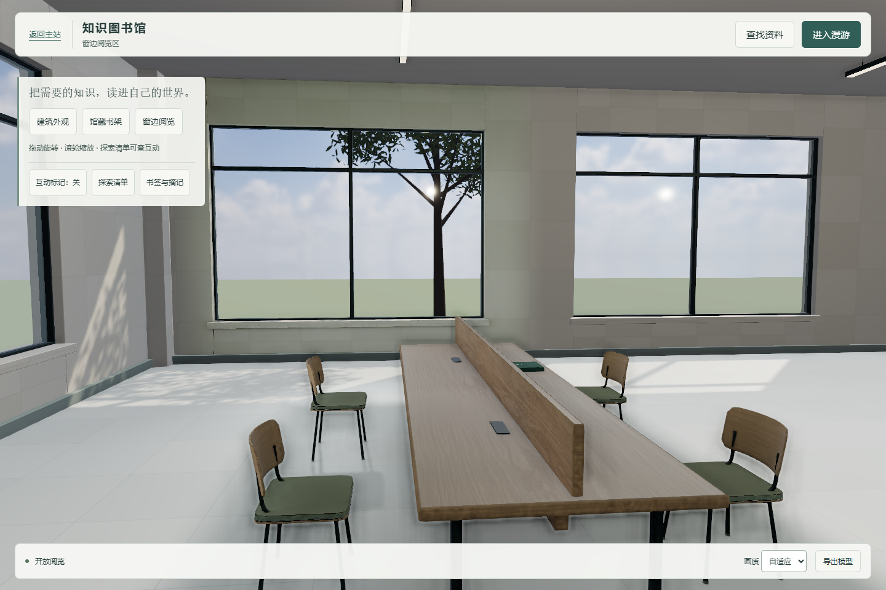
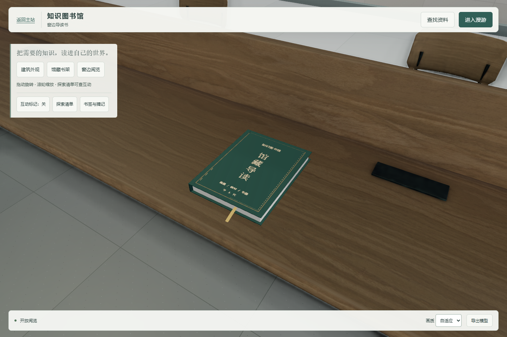
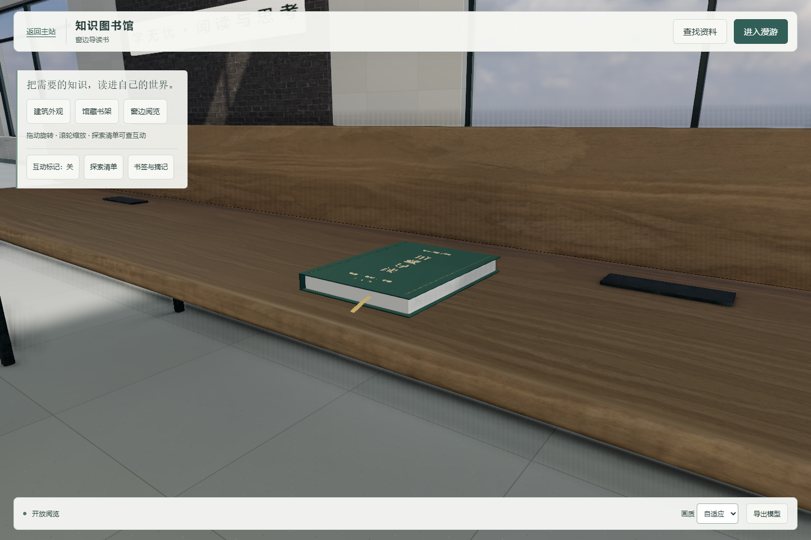
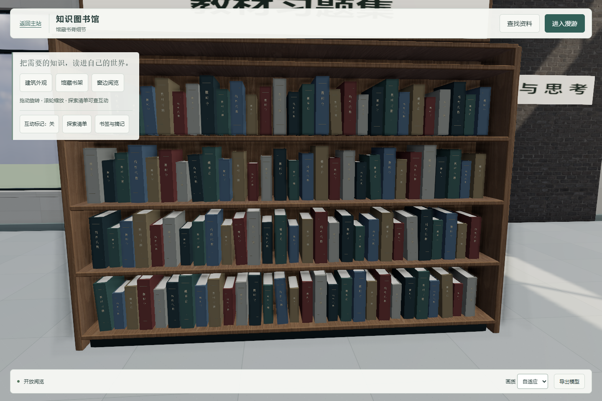

# 书本细节与查阅输入修复

基于仍 open 的 PR #55 head `fdbce422d758120802a362151589a4484ff30f08`，工作分支 `feature/c-library-book-details`。核对 GitHub main 为 `2c1e9b0c44002f884077924b107e603ecf3d7cac`；本轮 PR 以 `feature/c-library-reading-shelf` 为 base，保持依赖关系，不合并或部署。

## 体验

运行入口：<http://127.0.0.1:5297/examples/library-3d/?view=sample>。本地预览 `http://127.0.0.1:5296/examples/library-3d/?view=sample`；可用 `?view=book` 看封面、`?view=bookEdge` 看书页和封皮截面、`?view=shelfDetail` 看书脊。返回原来的 `sample` 即是两桌八座的整体视角。

## 改动

`src/books.js` 以程序 Canvas 纹理和 Three.js PBR 几何制作布纹封面、浅色纸芯、分层书边、书脊索引字、硬封面压印、装订槽和布书签。4 组书架保留原来的 464 本布局、坐标、尺度和分类配色；每组使用实例化书壳、实例化纸芯和合并书脊图层，控制 draw calls。桌面两本导读书增加封皮、纸芯、书脊、烫色文字和书签。纹理、材质和几何由 building 的同一 dispose 遍历释放，没有外部字体或贴图依赖。

书架脊文字是分类主题样例，不代表 464 本逐册真实目录。导读书使用现有实时 PBR 光照；不改 R1 的接收体、UV1、atlas、HDR 或灯光，不对新增书本冒称已烘焙。现有接收 GLB 与 Blender 原件没有覆盖。

按 E 打开目录时，目录会在同一 keydown 期间同步聚焦搜索框，浏览器又把 E 的默认字符输入写入框中。现在激活键被消费到 keyup，包含自动重复；修饰键、输入法 composition 不触发场景操作。松开后搜索支持正常 e、中文和数字。

## 验证

- `book-details-results.json`：四类书架、检索台长按 E、真实文本输入、修饰键及 composition、座位入口、书本阅读、GLB 导出，8 项通过。
- `interactions-results.json`：既有 21 项互动回归。
- `r1-lighting-results.json`：11 项 R1、失败回滚、释放和 BFCache 回归；模型网格基线按新增书本细节更新。
- `acceptance-results.json` 保留首次 SwiftShader 无头运行记录：业务部分 16 项通过，之后的 100 帧采样在 30 秒内超时。
- `acceptance-results-d3d11.json` 是随后在 Windows Intel D3D11、隔离后端和新 DATA_DIR 上的完整复跑，23/23 通过；没有使用线上账号或数据。
- `performance-results-d3d11.json`：Windows Intel D3D11 连续移动 20 秒、390×844 模拟 12 秒，桌面 60.0 FPS、P95 16.8 ms，窄屏 60.0 FPS、P95 16.7 ms，两者超过 50 ms 的帧均为 0。
- `performance-results.json`：较早的独立连续采样报告；首屏着色器预热期间的长帧保留在报告中。
- `node --run check`（server）：34 个前端文件语法、412 个 ID 与运行时引用检查通过。

真实截图由 Chromium 的 D3D11 渲染生成。物理手机未实测。本轮只更新 C 图书馆源码、构建 bundle、相关 C 专项测试和验证证据，没有包含其他团队工作，也没有重复 #41 历史证据。
