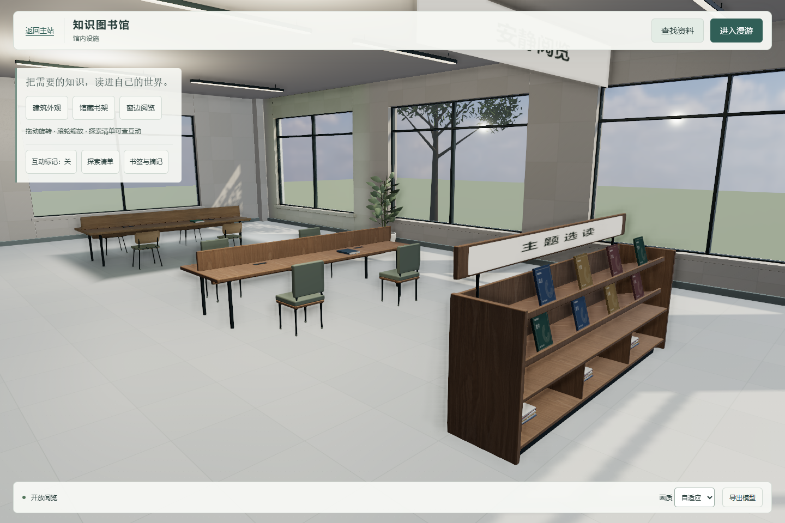
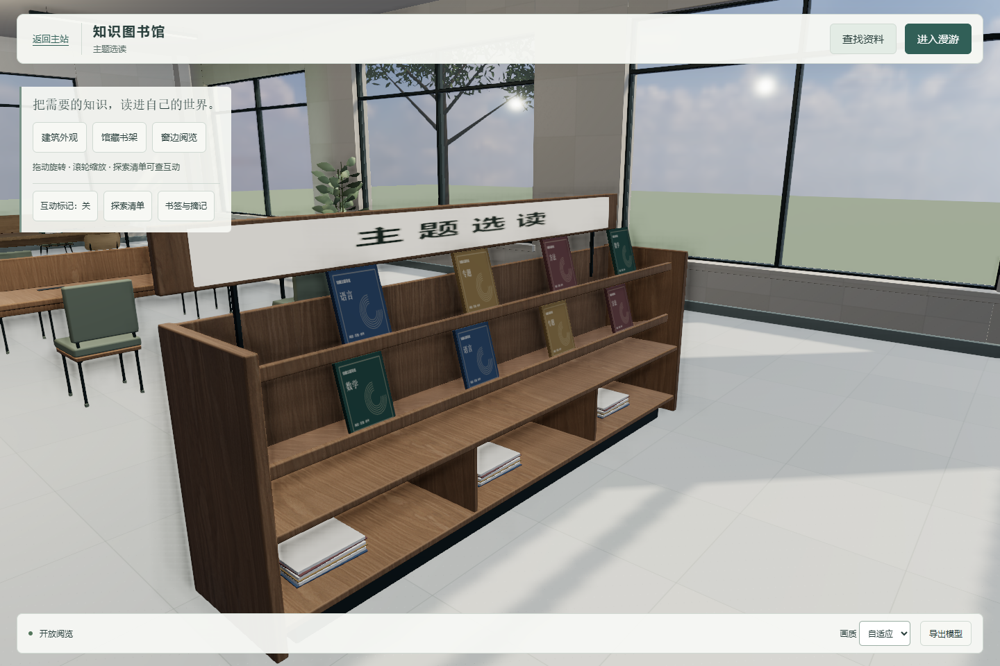
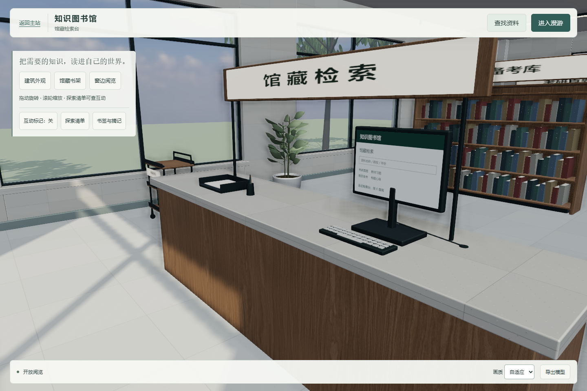
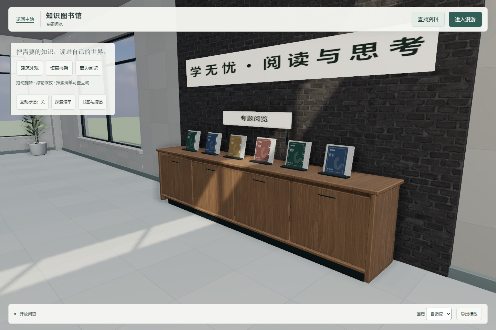
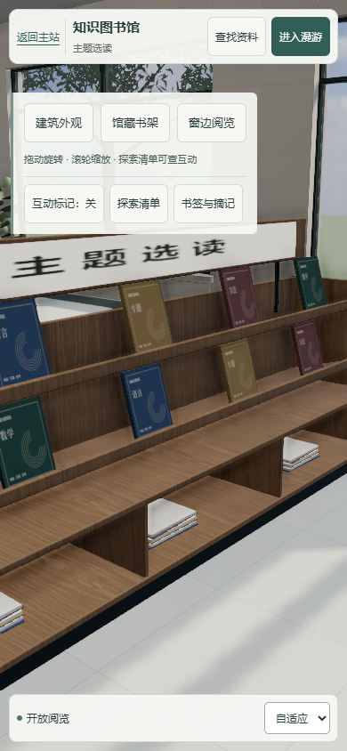

# 馆内设施与细节补充

基于 PR #66 的 `a35beb567bb45528465717a46076ddf23930c24d`，分支 `feature/c-library-facilities`。本轮核对 main 为 `3ba52d832e57098eabd462247f8098d628615754`；从共同祖先到该 main 的 C 图书馆文件没有新增修改。本轮 PR 以 `feature/c-library-book-details` 为 base，仅包含 C 增量，不合并或部署。

## 体验与设施

本机后端入口：<http://127.0.0.1:5297/examples/library-3d/?view=facilities>。保留 `?view=sample` 的原窗边机位；细节可切换 `?view=display`、`?view=enquiry`、`?view=topics`。服务使用已有隔离体验数据；回归在另一隔离后端 5299 和预览 5296 运行。

| 固定设施 | 中心位置 x / z（米） | 占地宽 / 深（米） | 细节与用途 |
| --- | --- | --- | --- |
| 主题选读陈列柜 | 6.60 / 5.95 | 3.44 / 0.76 | 两层斜面、挡书条、封面纸芯、下部收纳、退台踢脚、顶牌连接杆；按 E 复用真实推荐阅读 |
| 后墙专题展架 | 0 / -8.22 | 4.25 / 0.76 | 圆角台面、四扇柜门、内凹拉手、六个托架；按 E 打开真实专题分类 |
| 检索台设备 | 原台面 -7 / 6.30 | 原台面 3.85 / 0.90 | 显示器底座、键帽、线孔和走线、纸盘、纸张、空心笔筒与铅笔；抬高原招牌并加安装杆 |
| 停放书车 | -10.60 / 5.85 | 0.83 / 0.66 | 三层托盘、挡边、立柱、扶手、橡胶轮、轮叉和轮轴 |
| 阅读告示架 | -3.30 / 6.50 | 1.10 / 0.56 | 橡木框、软木底、连接腿与落地脚 |
| 三盆室内植物 | -10.70 / -7.75；10.60 / -1.05；-10.65 / 3.40 | 每盆 0.72 / 0.72 | 陶盆厚口、内收泥土、底圈、连接茎和叶柄、弯曲叶片；126 片叶用实例化绘制 |

物体保留米制与现有世界坐标；固定设施设置碰撞。中央约 3 米通道在 z=-6.5～8 范围内保持畅通，四书架、八座、检索台和两个新增入口均能从入口侧连通。操作位置分别为主题柜 `(6.6, 7.2)`、专题架 `(0, -6.75)`。门、漫游和座位逻辑沿用原实现，18 个互动点默认隐藏。

## 资源与光照边界

源码为 `src/facilities.js`；由 `src/architecture.js` 挂入 building，入口在 `src/app.js`，图标在 `src/interaction-guide.js`。材质沿用白橡木、石材、纸张和深色金属，补充少量搪瓷、软木、叶片材质及 Canvas 封面/屏面；无新增外部图片、字体下载或重型依赖。封面是分类主题导览图形，不冒充逐册真实封面；检索屏是固定指引，走近按 E 后使用实际目录。书车、柜门和植物本轮为固定陈设，未实现搬运、借还或收纳交易。

设施按分组及材质合并重复零件，保留各设施分组、组件名称和植物实例。几何、材质、贴图全部挂在 building 的同一所有权树内，由现有 Set 去重的 dispose 释放。运行时导出的 GLB 保留设施，所有图像内嵌；测试导出的约 30 MB GLB 未重复提交，可从页面“导出模型”获得。

新增设施使用实时 PBR；屏面只有低强度材质自发光，不新增实时灯。R1 的 47 个接收面、50 个几何、UV1、EXR atlas、曝光与灯光未改。原 `assets/wenku-library.glb` 和 `Library_Editable.blend` 保留；本轮原件与新增运行时设施的关系及散列见 `version-audit.json`。如将来把新设施纳入烘焙，需要独立整理 UV 与重新烘焙，现有纹理 UV 不代表 lightmap UV。本轮不宣称全馆照片级完成。

## 真实截图

## 验证

- `facilities-results.json`：6/6，实际碰撞图连通、七处新增落地设施碰撞、从中央通道实际走到两处新入口、真实 PDF 正文、桌面/横竖窄屏与 GLB 内嵌图像。
- `acceptance-results.json`：23/23，主站接入、行走碰撞、真实阅读、隔离账号上传及退出、窄屏、模型导出等。
- `book-details-results.json`：8/8，保留 E 的首次/长按消费，松开后正常 e、中文、数字输入。
- `interaction-results.json`：21/21；`reading-shelf-results.json`：15/15；`r1-lighting-results.json`：11/11。R1 专项仅把场景总网格硬编码改为接收体切换的数量差及原场景回退比较，不改 #41 已关闭的释放时序逻辑。
- `node --run check`：server 检查、34 个前端文件语法和 412 个 ID 引用通过；构建与 `git diff --check` 通过。
- `performance-results.json`：Windows D3D11，真实 RAF 持续前进转向，流畅画质。1440×960 持续 20 秒约 59.55 FPS，P95 16.7 ms，1 帧超过 50 ms（166.7 ms）；390×844 模拟 12 秒约 60.00 FPS，P95 16.8 ms，无超过 50 ms 的帧。原始长帧完整保留；未实测物理手机，不把一次采样当作所有设备的保证。

截图由实际 Chromium 运行场景取得。只提交本轮选取截图和报告；临时失败截图、试验目录、隔离账号数据、测试导出 GLB，以及 #41 和 #66 的历史证据均未重复打包。
