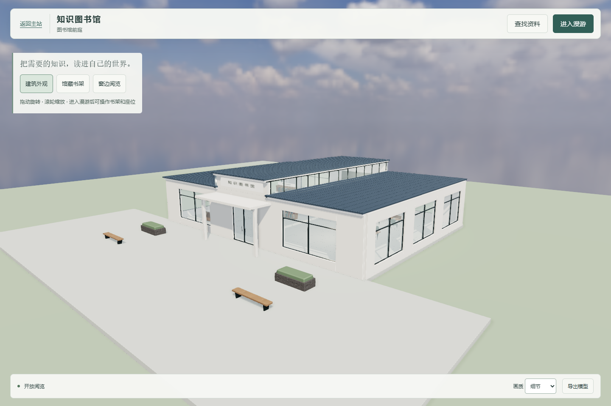
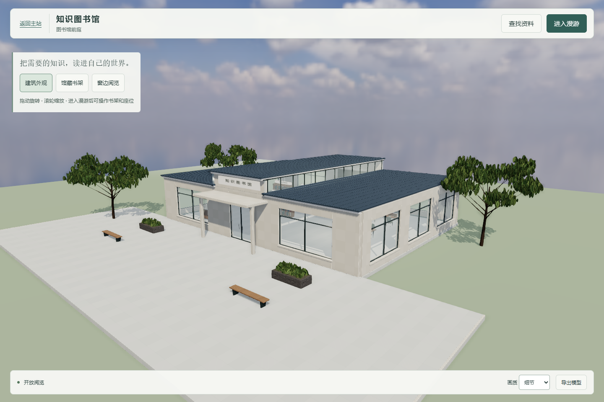
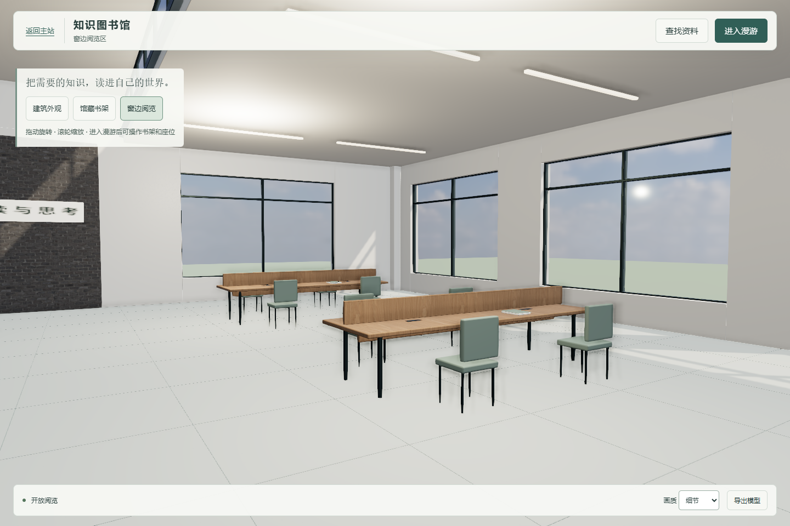
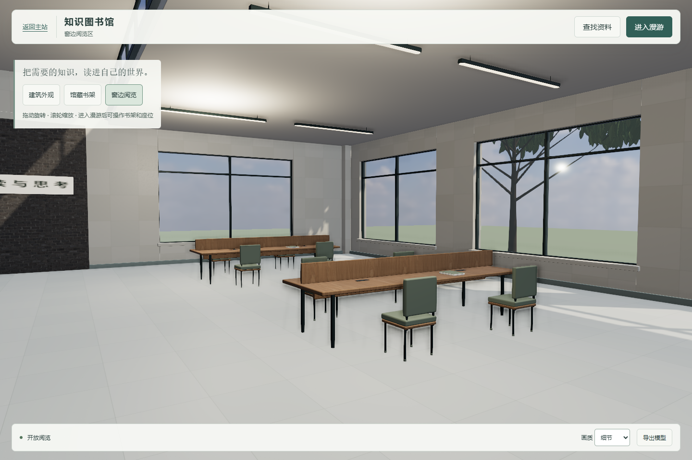
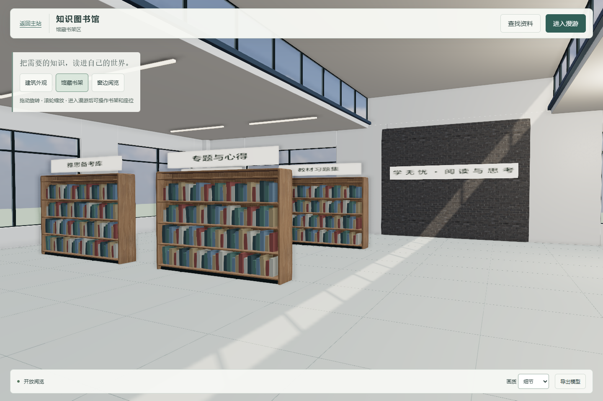
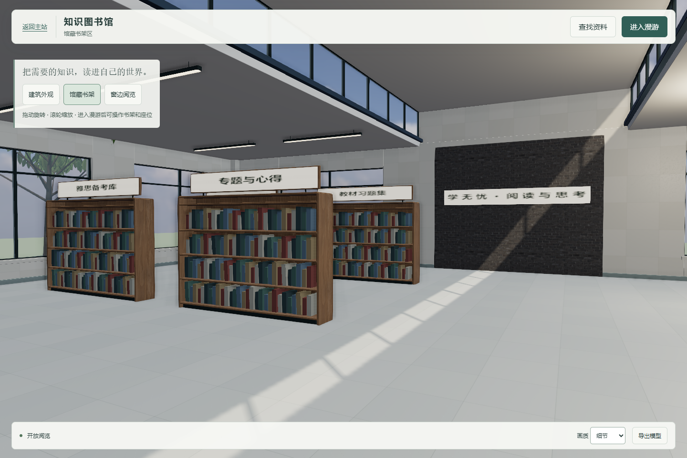

# C 图书馆 · PR 审查后的视觉细化

依据用户提供的《PR审查结论与修改任务.md》处理 C 的反馈。该审查确认 `7bdc843` 的功能原型可接收、未发现阻塞合入问题，同时指出光照层次、表面细节和场景环境仍有原型感。本次仅细化图书馆，不把 CI 或功能通过写成照片级视觉通过。

## 逐项处理

| 审查反馈 | 本次实现 | 检查证据 |
| --- | --- | --- |
| 光照层次不足、表面容易显平 | 降低半球和 HDR 环境填光，校准太阳/阅览辅助灯强度，保留窗侧日光与缓存实时阴影 | 同机位 `before-reading.png` / `after-reading.png`；流畅模式 `after-reading-fluid.png` |
| 表面与构件细节不足 | 石材板块/地砖分缝与细颗粒、织物凹凸；补椅背连接、椅座支撑和脚垫、窗台、踢脚、标牌背板/立杆、灯具外壳/吊杆、木坐凳分条 | `after-hall.png` / `after-reading.png`；更新 GLB / Blender 工程 |
| 环境原型感明显 | 图书馆周边补 3 株连通枝干和实例化叶片的树、花池植被与庭院收边，增加窗外环境及透过窗户的阴影；新增树干碰撞 | `after-exterior.png`；树干阻挡和全部座位可达检查 |

地面分缝改用有 mipmap 的材质细节，移除了易出现点状闪烁的抬高窄条。后墙中心为实体砖墙区域，取消其背后无效的被遮窗洞及外凸窗台。没有改入口尺寸、书架分类、桌椅布局、阅读/上传业务或主站公共文件。

叶片轮廓、织物和板材纹理均由代码确定性绘制，不是 AI 生图。沿用原 Poly Haven 素材与来源记录，没有引入另一套引擎、外部图片请求或新的运行依赖。

## 同机位比较

比较均来自真实程序，使用相同 1440×960 视口、相同预设机位、同一 Intel Direct3D11 浏览器和细节画质。改前为 `7bdc843`，改后为本次图书馆代码；没有对截图做合成或替换建筑。

| 建筑外观 | 改后 |
| --- | --- |
|  |  |

| 窗边阅览区 | 改后 |
| --- | --- |
|  |  |

| 馆藏书架 | 改后 |
| --- | --- |
|  |  |

## 复核结果

- 原有专项 **23/23 通过**：实际 PDF、翻页、404、搜索、输入隔离、门/墙窗碰撞、入座退出、真实隔离后端上传与正文、账号清理、窄屏、横屏、200% 放大、子目录和本地 PDF Worker、GLB 导出。
- 新增 `tests/visual-review.cjs` **4 组检查通过**：固定机位高画质渲染；8 个座位逐一坐下/站起；新增树干碰撞；流畅模式及静态阴影缓存。浏览器无脚本错误、无失败资源请求。
- `npm run check` 通过，含 34 个主站前端脚本、412 个 HTML ID；图书馆源码和新增脚本语法检查通过。
- 使用独立端口 **4296 / 4297** 和 `work/library-review-data`，没有停止原有服务、使用线上账号或把临时上传数据放入正式目录。

| 持续前进和转向 | 时长 | 平均 FPS | P95 帧间隔 | 最大间隔 | 超过 50ms |
| --- | ---: | ---: | ---: | ---: | ---: |
| 1440×960 桌面 | 20 秒 | 60.0 | 16.8ms | 16.8ms | 0 |
| 390×844 窄屏模拟 | 12 秒 | 60.0 | 16.7ms | 16.8ms | 0 |

设备：Windows / Chromium / ANGLE Intel Graphics Direct3D11；流畅画质、0.85 像素比例、SSAO 关闭。帧间隔直接由 requestAnimationFrame 采样，没有使用限幅的移动时间。上述仅为本机样本，不能保证其他设备；窄屏仍为桌面模拟。

当前场景 88 个网格、80,810 个潜在三角形、5,338 个实例（464 个书脊及 4,874 个叶片）、60 个碰撞体。树和叶片只在初始化时生成；没有每帧重建几何，静态阴影保持缓存。首轮仍为 18 个子资源，编码体积 7,240,190 字节，比首版仅增加 6,013 字节。导出 GLB 不是运行时加载资源。

更新后的 GLB 已从实际程序导出。Blender 4.5.3 LTS 工程重新生成并重新打开，5,457 个对象、5,421 个网格对象和 20 张打包纹理，已保存为压缩工程。

## 边界与剩余限制

本次是针对三项视觉意见的可检查改进，仍是实时建筑原型，没有新的烘焙图，不声明照片级验收通过。没有修改或接管 A/B；统一校园总装、跨板块材质终验和补图继续由总指挥安排。首版全站测试的学习引擎环境失败说明保留在上一级验证记录，本次未变更该学习服务，也未重复运行无关业务全套测试。

原始结果：`acceptance-results.json`、`visual-review-results.json`、`performance-results.json`、`blender-validation.json`。
