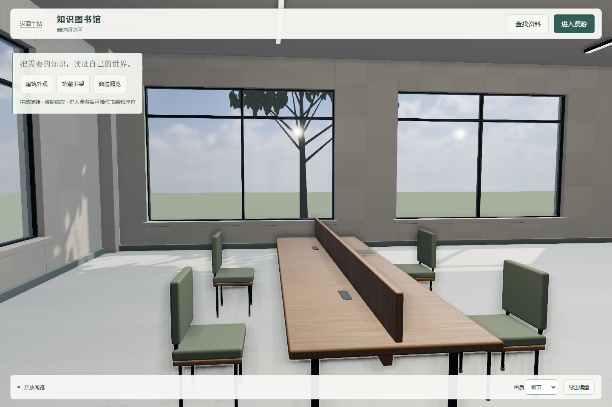
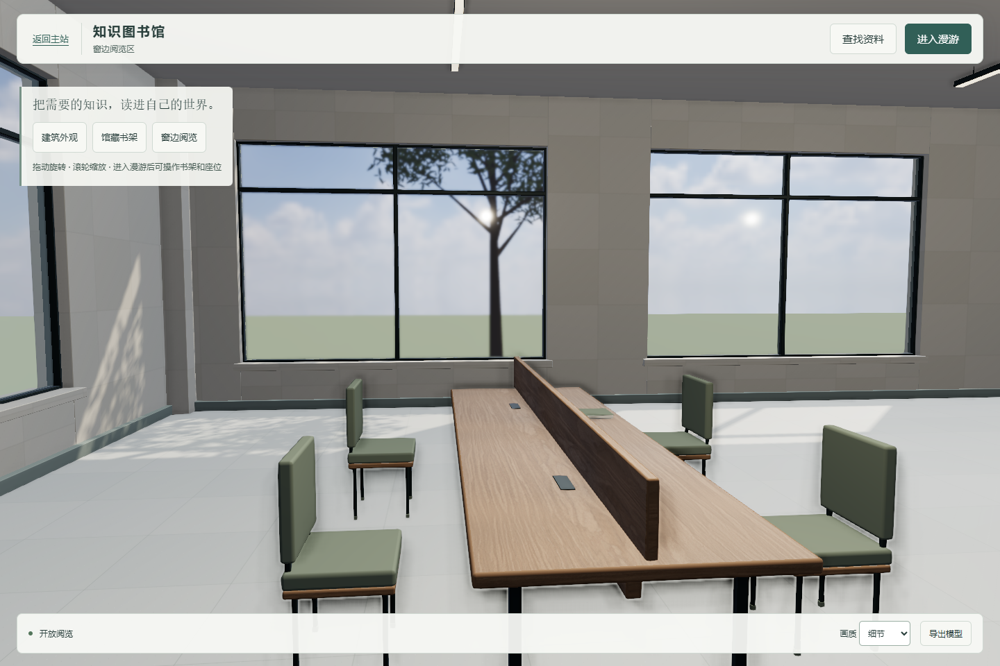
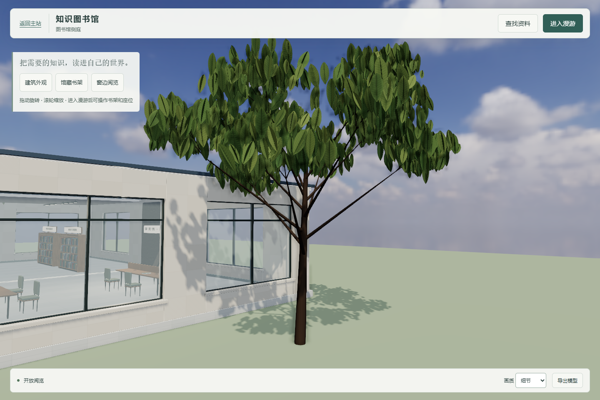
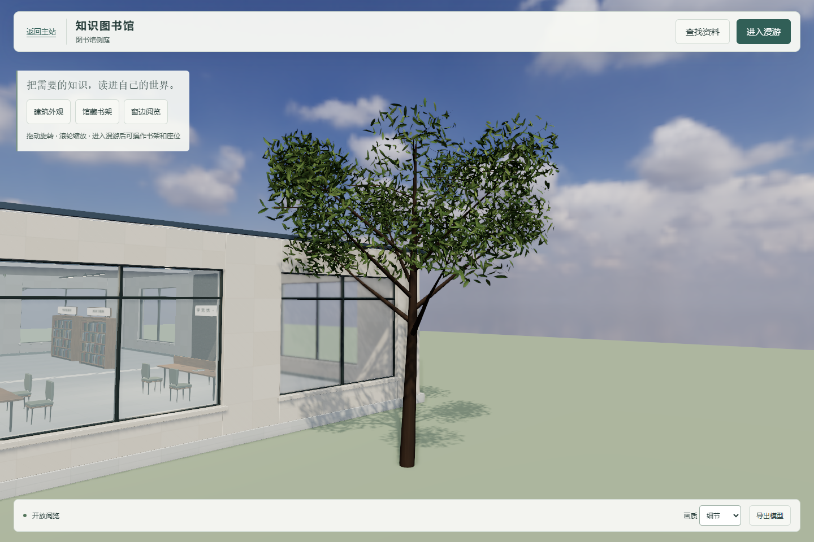

# 第二轮审查后的窗边精修样板

2026-10-19，承接审查版本 `00412405dff55053e07cf1c3d36f3a56879b3cc6`，继续追加到 [PR #26](https://github.com/Dallovers/xuewuyou/pull/26)。本次只做一处样板，不推广到全馆；尚未达到照片级或最终视觉验收。

## 选定范围及实际变化

- R1 阅览桌及四把椅子：沿桌面长边校准橡木纹向，保留同源木材和原有尺寸；软包改为约 2mm 织纹间距的细法线，避免原先 3mm 凹凸幅度。第二组桌椅保留原样。
- 东侧一窗格 `x=12, z=-5.8`：由透明混合改为非金属物理透射，透射率 0.96、IOR 1.5、厚度 12mm、粗糙度 0.008；加入距离衰减。其余玻璃保留原样。实时屏幕空间透射仍有采样／柔化局限，不等于离线玻璃渲染。
- 窗外树 623 `x=16, z=-4`：从大交叉平面叶片改为标称 9×24cm、有曲面的叶片；28 个不规则枝叶簇、4480 个实例，并补充末端细枝。保持三棵树总数和全部树干碰撞位置，未新增树木。
- 石材延续已有约 0.8m 分格，桌椅和窗洞几何尺寸保持不变。太阳、环境、曝光、辅助灯参数全部延续审查版本；窗边阴影变化来自这一棵树。没有继续堆加全馆纹理、业务或新外部图片。

## 同机位对比

截图为实际浏览器运行，1440×960、DPR 1、细节画质，未做图片重绘。修改前使用 `0041240` 的几何、材质和灯光，仅补入相同检查相机及位置标签。两个视角分别固定桌椅与树冠，不是自由移动后挑选角度。

| 视角 | 相机 eye | target | 纵向 FOV |
|---|---|---|---|
| 窗边样板 | `[2.7,1.7,-5.2]` | `[9,1.25,-4.6]` | 55° |
| 树冠样板 | `[23,3,4]` | `[16,3.6,-4]` | 55° |

窗边修改前：

窗边修改后：

树冠修改前：

树冠修改后：

[流畅模式同机位](after-sample-fluid.png) · [390px 窄屏模拟](after-sample-narrow.png)

## 实际验证

使用独立预览 4396、后端 4397、全新本地 DATA_DIR；没有停止其他服务或使用线上账号。

| 项目 | 实际结果 |
|---|---|
| 原图书馆专项 | 23/23，通过实际阅读、上传、账号退出清理、门／行走／座位、404、窄屏和生产子目录 |
| 上轮视觉／通行检查 | 4/4，包括全部八座入座／站起、树干碰撞、静态阴影缓存 |
| 新样板固定视角 | 细节／流畅／窄屏均完成，无脚本错误、失败资源和横向溢出 |
| 主站检查 | `npm run check` 通过，34 个前端脚本及 412 个 HTML ID 引用 |
| GLB 改动边界 | 14 个非样板分组的几何／变换／材质指派一致；其他 3356 个植被实例的变换及颜色逐项一致 |
| GLB 材质 | 仅一窗格包含透射及体积扩展，软包含内嵌法线纹理 |
| Blender | 4.5.3 LTS 重建后重新打开成功；22 张图像全部打包，实际玻璃透射值 0.96，两台检查相机存在 |

本机 Chromium Direct3D11（Intel 核显），流畅画质关闭 SSAO、比例 0.85。以下是未截断的真实 RAF 帧间隔，窄屏为桌面模拟：

| 采样 | 时长 | 平均 FPS | P95 | 最大 | >50ms |
|---|---:|---:|---:|---:|---:|
| 1440×960 持续行走／转向 | 20s | 60.0 | 16.8ms | 16.8ms | 0 |
| 390×844 持续行走／转向 | 12s | 59.9 | 16.7ms | 33.3ms | 0 |
| 窗边透射样板固定视角 | 10s | 60.0 | 16.7ms | 16.8ms | 0 |

场景 98 个网格、115986 个潜在三角面、8300 个实例、60 个碰撞体。与上一轮相比潜在三角面增加约 43.5%；样板透射增加渲染工作。本机样本通过不构成其他设备性能保证，是否扩大应用需要另行评估。

原始记录：[专项](acceptance-results.json)、[视觉／通行](visual-review-results.json)、[持续性能](performance-results.json)、[样板视角与性能](sample-review-results.json)、[导出模型边界](model-scope-results.json)、[Blender 重开](blender-validation.json)。首版完整后端回归中的学习引擎依赖缺失记录仍保留，本轮未重跑 A/B 全套业务。

## 复现

从仓库根目录运行 `node examples/library-3d/server.mjs`，访问：

- `/examples/library-3d/?view=sample`：窗边样板。
- `/examples/library-3d/?view=sampleTree`：树冠样板。

选择「细节」或「流畅」切换同机位画质；原有三个视图和业务入口继续使用。设置好 `PLAYWRIGHT_MODULE`、`LIBRARY_URL`、`LIBRARY_OUTPUT` 和 `LIBRARY_D3D11=1` 后，运行 `node examples/library-3d/tests/sample-review.cjs` 重拍样板；原专项还需配置隔离后端 `LIBRARY_BACKEND`。

`tests/audit-sample-model.py before0041240.glb assets/wenku-library.glb report.json` 对比前后实际导出文件；其基线是 Git 历史 `0041240:examples/library-3d/assets/wenku-library.glb`。Blender 工程的 `Window sample`、`Tree 623 sample` 相机对应检查方向；其灯光供编辑使用，不宣称与浏览器 HDR／屏幕效果一致。

本轮没有合并、部署、接管 A/B 或生图。没有新增图片需求；这处样板交由总指挥判断是否接受及是否推广。
