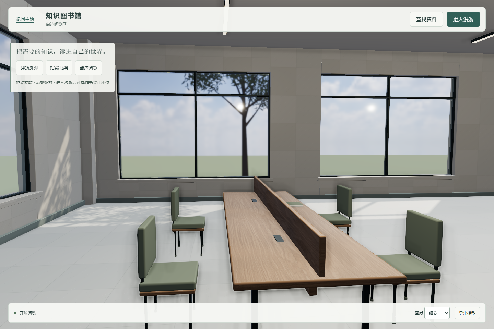
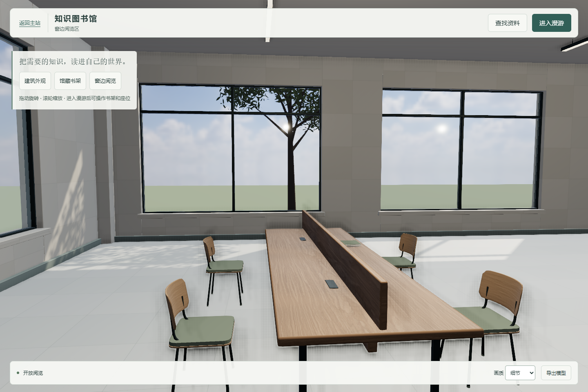
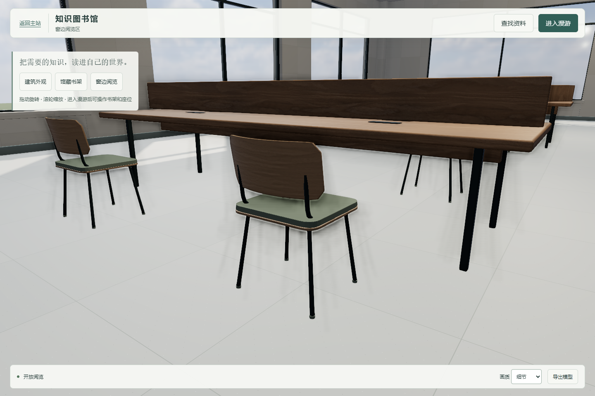
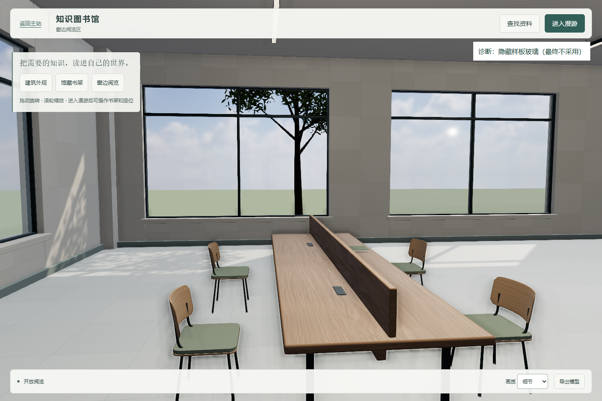
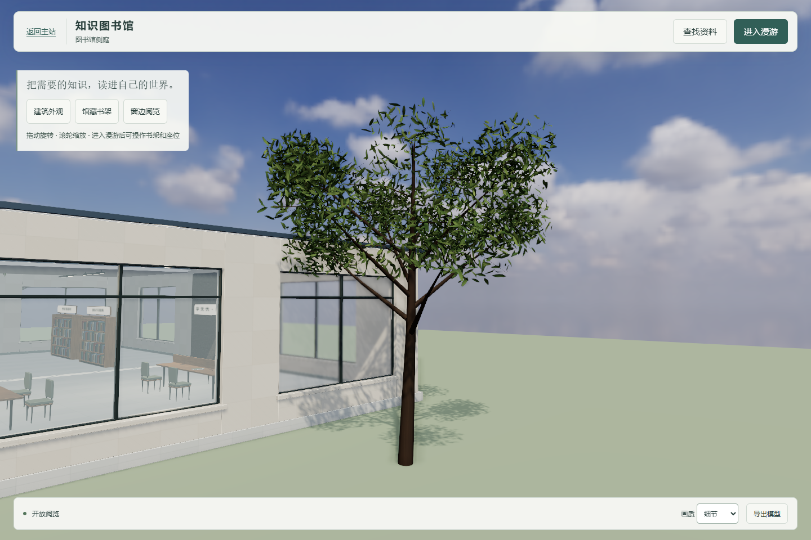
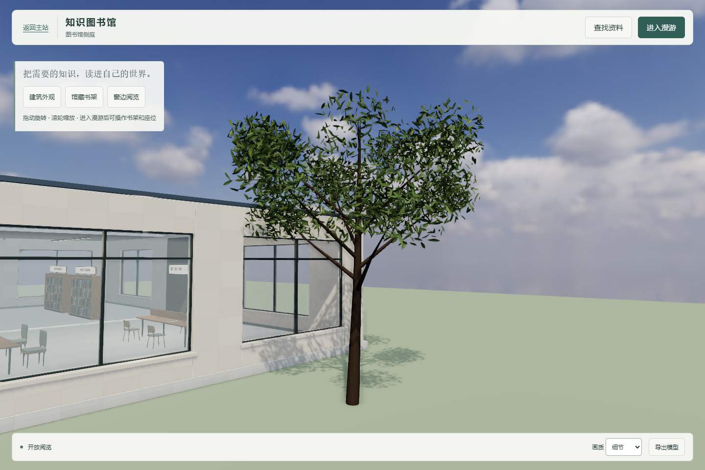
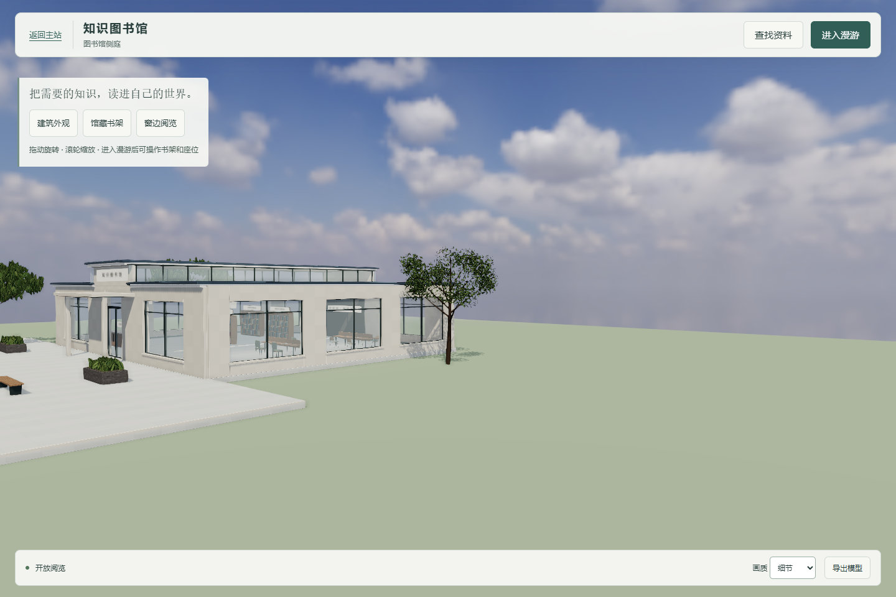

# 第三轮反馈：R1 曲木椅、玻璃诊断与树冠成本

承接 2026-10-20 的 `C第三轮_参考图与执行任务.zip`，基线 `ac1369ab6466a9ce620ac98fc8b5f545eb3da6dc`，继续使用 [PR #26](https://github.com/Dallovers/xuewuyou/pull/26)。范围仅为 R1 四椅、既有东侧样板窗格和代表树 623；没有推广全馆、修改 A/B 或新增业务。本轮未合并、部署或生图。

## 参考目标与真实程序

下方所有带“修改前／修改后／诊断”的截图来自实际浏览器。`reference-chairs-generated.png`、`reference-tree-generated.png` 是总指挥提供的**生成目标**，不属于实际程序成果，也没有作为场景贴图或光照图使用。图片里额外的远景建筑、植被及家具布局没有照搬。

## R1 四把曲木椅

浅橡木弯曲背板、薄鼠尾草绿坐垫、深灰细金属腿。背板采用实际分段曲面加厚及边缘小倒角，沿水平圆弧包裹并约 10° 后倾，非给直立方块加倒角。木材沿用既有橡木来源，只对这四椅的颜色纹理作浅橡木混合，保持原有全局灯光和曝光。

四椅复用同一组背板、座壳、软垫、背部连接架、外撇腿和脚垫几何，材质共享；GLB 审计确认四组模块复用相同网格。背板中段与侧缘的实际深度差约 72.7mm，靠背顶 0.798m，坐垫顶 0.460m、厚 28mm。其余家具及四个座位中心位置保持，朝向桌面中线。背板与座面留缝，支架连续连接座壳和背板。

新椅的宽度保持约 0.51m。R1 四个碰撞盒从 `0.54×0.55m` 调为 `0.54×0.60m`，覆盖后倾背板和外撇腿；R2 保持原值。入座视点仍为 1.18m，站起点仍在原有后方通道，已按新座高与碰撞范围验证。八座各三次完整入座／站起，24 次均成功且起身后不在碰撞体内。

| 修改前：实际程序 | 修改后：实际程序 |
|---|---|
|  |  |

单椅近景，实际程序：

## 样板玻璃三组诊断

同一新场景、同一窗边相机、1440×960、DPR 1、细节画质，以下截图均带浏览器内的诊断标注。只切换样板玻璃，其余几何与灯光保持一致。

| 无玻璃诊断：最终不采用 | 上一轮材质 | 调整后：最终保留玻璃 |
|---|---|---|
|  |  |  |

无玻璃诊断的树干边缘清晰，旧透射路径明显柔化，说明柔化并非仅来自背景 HDR 的源分辨率。检查所用 Three.js r170 本地源码发现：物理粗糙度最低限制为 0.0525，透射再使用 mip 层及 bicubic 采样；双面透射还包含背面处理。本轮只对这一块抛光玻璃改为正面渲染，并在透射 LOD 小于 0.75 时采用全分辨率基础层采样，其他情况沿用引擎默认路径。没有修改引擎全局 ShaderChunk。

玻璃仍为非金属物理材质，IOR 1.5、透射率 0.96、粗糙度 0.008；保留物理 Fresnel 反射、体积衰减和实体窗格。**几何厚度 12mm** 指网格两表面的距离；**材质 thickness=0.012** 指用于计算透射光路和吸收的光学参数，两者在这里取相同数值，但修改材质数值不会修改网格。其他窗格、曝光及所有灯光参数保持基线。

采样校准是这一运行页的 Three.js 实现，不写入标准 glTF 材质规范；GLB／Blender 保留标准透射和体积参数，其他查看器的采样清晰度可能不同。当前方案仍使用屏幕空间透射，不等同于离线路径追踪。

## 代表树：近景与远景

树的总数仍为三棵，代表树枝干、28 个不规则簇、位置及碰撞保持。只改树 623 的叶面表示；另外两树及原有 3356 个树叶／花池实例的变换与颜色逐项一致。

| 代表树叶面 | 基线 | 新近景 | 新远景 |
|---|---:|---:|---:|
| 实例 | 4480 | 4480 | 2240 |
| 每实例三角面 | 8 | 4 | 2 |
| 叶面潜在三角面 | 35840 | 17920 | 4480 |

近景保留曲面中脊和全部实例，减半单叶面数。远景从每个簇均匀选取一半实例，叶片面积补偿约 2 倍，保留簇状轮廓和连接枝干。距离树中心超过 30m 转远景，小于 26m 恢复近景，避免在阈值处反复切换；没有每帧重建树木。静态阴影先由初始近景几何生成并缓存，距离切换不触发全馆阴影重算；门运动仍沿用原有阴影刷新规则，因此远景轮廓与缓存阴影是近似关系。

| 近景基线 | 新近景 |
|---|---|
|  |  |

同一远景相机强制比较两档，而非拉远相机制造视觉提升：

| 强制新近景 | 强制新远景 |
|---|---|
|  |  |

## 实际成本与帧耗

独立预览 4496、隔离后端 4497、全新本地 DATA_DIR，没有使用线上账号或停止别的服务。Chromium 无头、Intel Graphics / ANGLE Direct3D11；版本及 renderer 原文见 JSON。截图为 1440×960 细节画质；下表为 1440×960 流畅模式、像素比例 0.85、关闭 SSAO。

基线源码从 Git 的 `ac1369a` 准备，只补入同样的单椅／远景检查相机；使用浏览器 route 加载基线 bundle，所有其他资源沿用同一本地服务器。前后测试串行运行。各固定视角预热后采 180 个 RAF，统计实际渲染工作量及 CPU 提交时间。提交时间不是 GPU 帧耗，也不作统计显著性结论。

| 固定视角 | 基线调用 / 渲染面 | 新版调用 / 渲染面 | 基线 / 新版平均 CPU 提交 |
|---|---:|---:|---:|
| 窗边样板 | 96 / 184612 | 103 / 153176 | 1.38 / 0.99ms |
| 树冠近景 | 136 / 209684 | 143 / 178248 | 1.64 / 1.22ms |
| 树冠远景 | 202 / 232000 | 209 / 173684 | 2.15 / 2.06ms |

模块拆分让调用数增加 7 次；当前样本的渲染面数下降约 15%—25%，不宣称所有指标都下降。全场选中近景档的潜在三角面为 100322，远景档 86882，分别比基线 115986 减少约 13.5% / 25.1%；这与包含多个渲染通道的实际渲染面数是两种口径。102 个网格；近景活跃实例 8300、远景 6060；保留近景实例缓冲用于快速切回，远景不等于释放一半内存。

持续按住前进与转向，测未经 dt 截断的 RAF 间隔：

| 持续移动 | 基线 FPS / P95 / 最大 | 新版 FPS / P95 / 最大 | >50ms |
|---|---|---|---:|
| 1440×960，20s | 60.0 / 16.7 / 16.8ms | 60.0 / 16.8 / 16.8ms | 前后均 0 |
| 390×844，12s | 59.9 / 16.7 / 33.2ms | 60.0 / 16.8 / 16.8ms | 前后均 0 |

固定透射样板另采 10s，约 60.0 FPS、P95 16.7ms、最大 16.8ms，无 >50ms。RAF 受浏览器调度和环境影响，可高于或受限于显示刷新；这不是实际显示器／物理手机帧率保证，也不与总指挥另一环境约 117—239 的 RAF 数值直接比较。窄屏为桌面模拟。

## 验证与工程交付

- 原专项 23/23；真实 PDF、真实隔离后端上传、账号退出清理、门／行走／座位、窄屏、404 和子目录通过。
- 原视觉／通行 4/4；新增 24 次八座循环、近远档切换、三组玻璃诊断、资源和浏览器错误检查通过。静态阴影缓存仍正常。
- 主站 `npm run check`：34 个前端脚本及 412 个 HTML ID 引用通过。图书馆源码和检查脚本语法通过；未重跑或验收 A/B 全套业务。
- GLB 审计：14 个非样板分组的几何／变换／材质指派一致、3356 个其他植被实例一致；不等于逐项证明所有共享材质参数。新曲木椅的中段曲率、坐垫厚度、四份网格复用和近景叶片面数已检查实际导出数据。
- Blender 4.5.3 重开通过，27 张图像全部打包；四台检查相机和默认隐藏的远景树替代集合存在。隐藏集合不是额外种树，避免与近景同时启用。没有烘焙。

主模型：`assets/wenku-library.glb`，完整导出固定为近景档；`assets/tree-623-far.glb` 为同位置单树远景编辑备选。Blender 同时保存近景完整模型和隐藏远景备选。浏览器导出完成后恢复自动距离策略。

原始记录：[业务专项](acceptance-results.json)、[视觉／通行](visual-review-results.json)、[样板](sample-review-results.json)、[本轮几何与工作量](after-round3-review.json)、[基线工作量](before-round3-review.json)、[新版移动](performance-results.json)、[基线移动](before-performance-results.json)、[GLB 边界及椅子曲率](model-scope-results.json)、[Blender 重开](blender-validation.json)。

## 复现

启动 `node examples/library-3d/server.mjs`，通过 `?view=sample`、`?view=chair`、`?view=sampleTree`、`?view=treeFar` 查看四个固定机位。选择细节／流畅切换画质。

`tests/round3-review.cjs` 拍摄本轮相机、诊断、24 次座位循环和工作量。`tests/prepare-review-baseline.py` 将 `ac1369a` 源码准备到工作副本之外，再用其 `build.mjs` 生成 bundle；设 `LIBRARY_BASELINE_BUNDLE` 指向该文件后，同一 `round3-review.cjs` 与 `performance.cjs` 可复测基线。其他环境变量沿用原专项：`PLAYWRIGHT_MODULE`、`LIBRARY_D3D11`、`LIBRARY_URL`、`LIBRARY_OUTPUT`；业务专项另需 `LIBRARY_BACKEND`。

当前仍是实时功能原型及一处视觉样板，外部地景仍较简略，没有宣称达到生成目标的照片级质量。暂不推广到全馆，交由总指挥复查后决定。本轮无新增生图需求。
