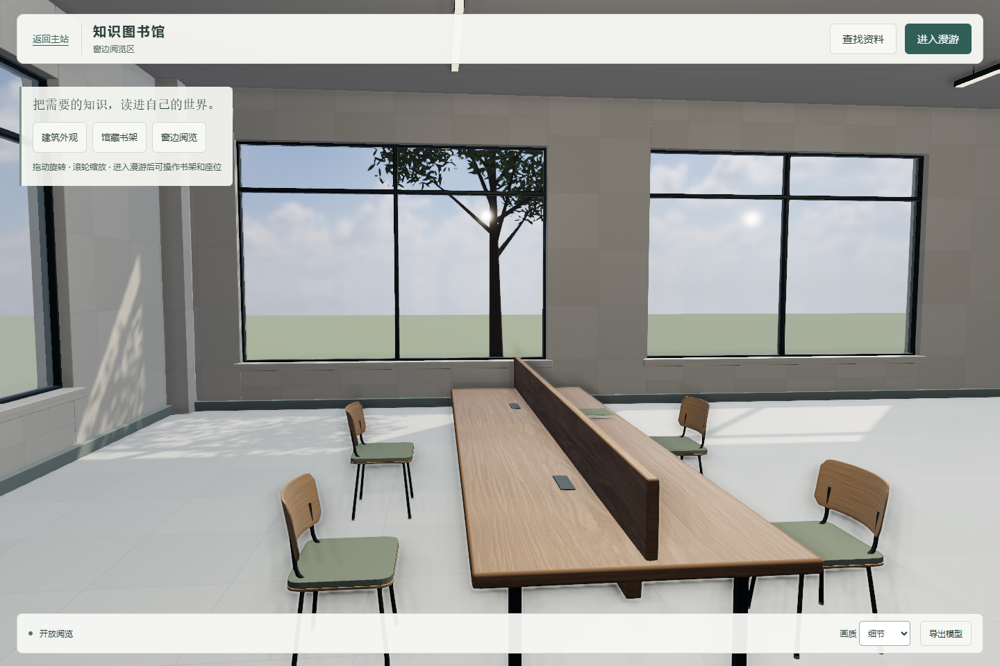
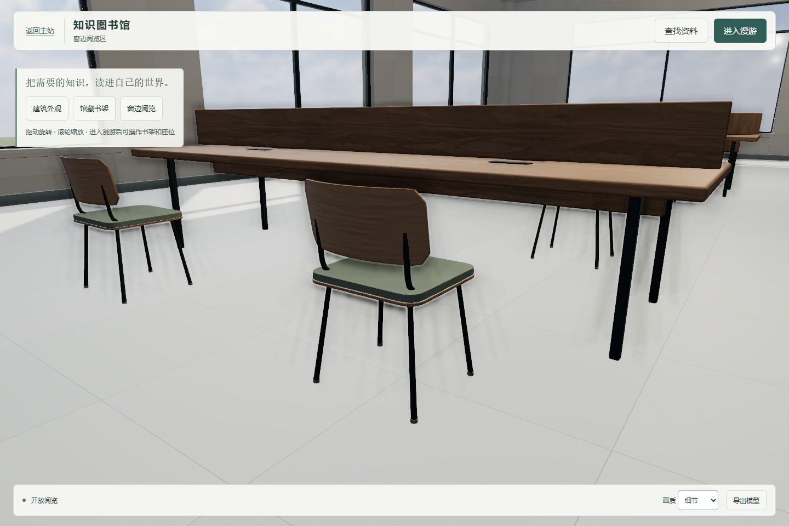
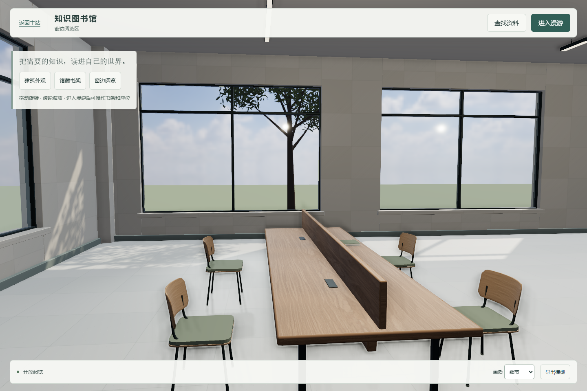
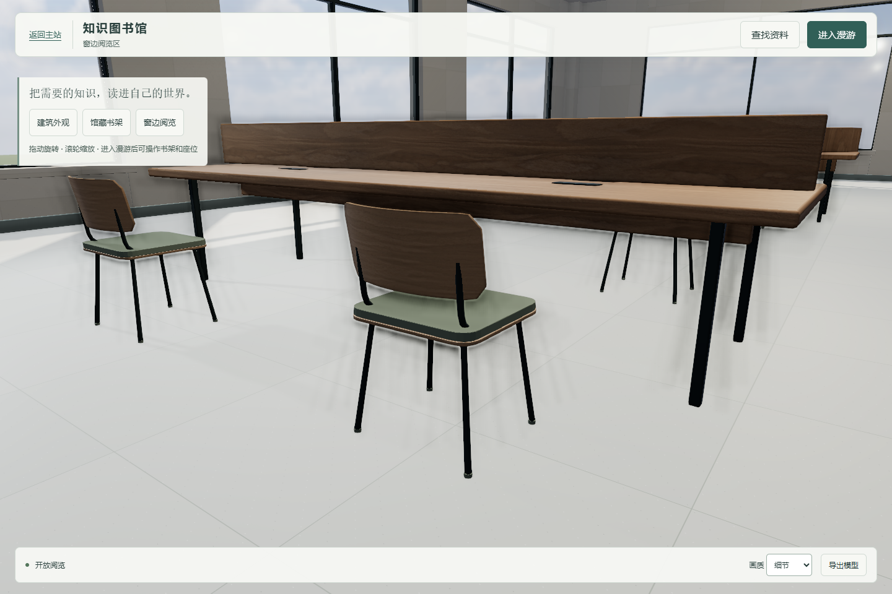
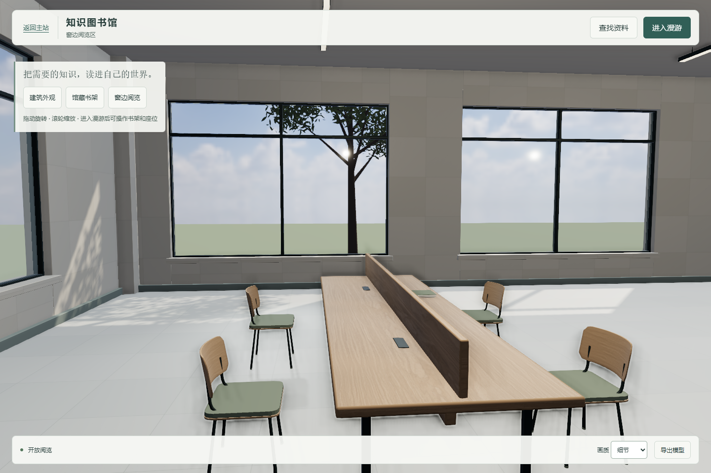
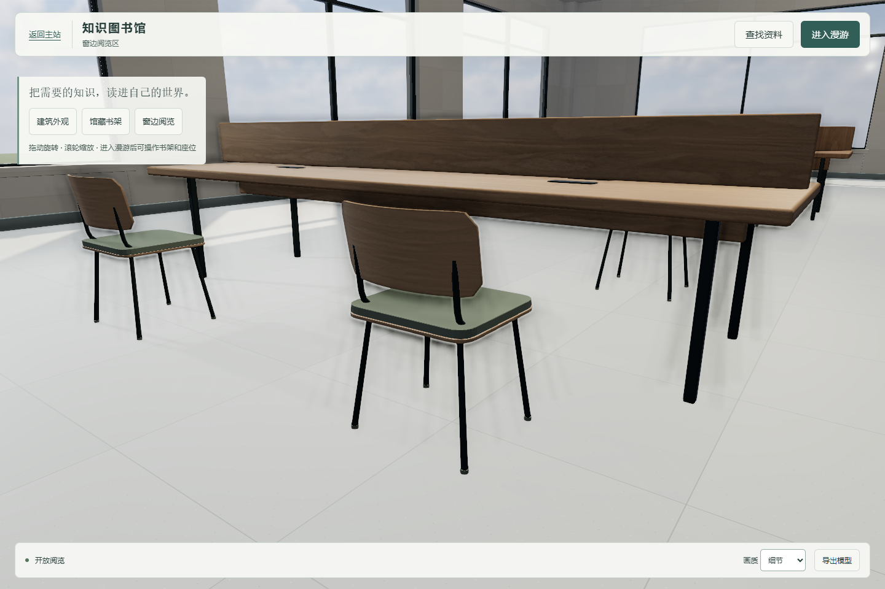

# 第四轮执行：main 集成与 R1 局部明暗

承接 `C第四轮_审查反馈与真实截图_v1.zip`，视觉／模型基线为 `21c9d11f35fb9fc7beea03b5bce3c042fca8187e`，继续追加到 [PR #26](https://github.com/Dallovers/xuewuyou/pull/26)。功能、四把曲木椅、样板玻璃和树 LOD 保留，不扩大样板。

## main 集成及缓存冲突

先读取最新 main `e87aff9`，实际三方合并只在 index.html 的相邻两条脚本出现冲突。逐行解决并同时保留：

| 脚本 | 最终缓存版本 |
|---|---|
| study-rooms.js | v3 |
| campus-registry.js | v6 |
| study.js | v11 |
| app.js | v55 |

未用包内整份 HTML 覆盖仓库。集成提交为 `296ccfe`。随后 main 合入 D 公共桥接 PR #28，更新到 `78efa41f60ccc45eb25addf629a51e995465857f`；已通过第二个合并提交完整合入，D 文件保持 main 内容。

旧工作区迁移后，旧路径下的部分未改动入口文件在 Node 中解析到迁移副本，导致第一次预览读取旧 HTML。已新建隔离工作树 `work/xuewuyou-round4`，确认 Node 的实际入口路径及 HTTP 内容与该工作树一致，再执行下列正式验证；未将早期路径排查结果写成通过。

- `npm run check` 通过：34 个前端脚本、412 个 HTML ID。
- 自习室及定时器生命周期回归 12/12：直接运行 main 的 `study-rooms.test.js` 与 `study-rooms-cleanup.test.js`，未改这些测试或业务。
- 浏览器实际检查四个缓存版本，图书馆入口和返回 `#wenku`、个人自习深链及多人自习导航通过，无脚本错误。
- [main 文件证明](integration-main-proof.json) 比较了关键 B／D 文件 blob，均与本次 main 相同。没有接管模型或跨模块验收。

## R1 逐项对比

固定既有窗边／单椅相机、1440×960、DPR 1、细节画质、曝光 1。太阳、环境、半球光和原有两盏辅助灯参数不变。以下全为真实程序截图，没有生成图、重绘或后期曝光加工。

诊断基线是在当前同一几何中关闭新增局部灯、恢复 `21c9d11` 的 R1 两张木纹；中间档只加入局部灯及接触阴影，最终档再校准 R1 两种木材。不是用不同机位或全馆统一提亮作对比。

| 阶段 | 窗边相机 | 单椅相机 |
|---|---|---|
| 基线：旧木色、关闭新增灯 |  |  |
| 接触／窗光：旧木色 |  |  |
| 最终：局部光及 R1 木色 |  |  |

新增一盏有范围限制的标准聚光灯，模拟 R1 窗口天空补光与近处接触阴影：26cd、范围 8m、外锥角 0.86rad、penumbra 0.95、平方衰减；局部静态阴影贴图 1024²、normalBias 1mm。它能在桌椅脚和附近墙地提供更细的遮挡与明暗过渡，是受控实时近似，**不是算出的全局间接光或新烘焙**。邻近表面可能有弱溢光，不声称所有非 R1 像素完全相同。

只调整 R1 桌板／隔板及曲木椅的橡木颜色图，减少背光深棕和过重木纹，保持原有 UV 尺度、粗糙度、法线、织物和石材参数。没有全馆改材质、曝光、树数量或几何布局。

本轮多一盏光源及一张局部阴影贴图和相关缓冲，有显存／光照计算成本。`reviewR1` 档位切换会触发纹理上传和阴影更新，截图阶段包含预热，不将其中滚动帧率当作持续移动性能。最终用户界面不增加这些诊断选项。

## 几何、材质与运行验证

- 图书馆专项 23/23，保留真实 PDF、隔离后端真实上传、退出清理、404、门、行走、座位、窄屏和子目录。
- 视觉／通行 4/4；八座各三次循环，共 24 次通过，起身落点无碰撞。
- 新阶段检查实际读取曝光与画质，三档均曝光 1、细节画质；最终流畅／390px 窄屏通过。
- 显式 dispose 后帧计数停止；新增灯的阴影资源及诊断材质／纹理纳入释放。此项不等于对所有浏览器 GPU 内存归零的证明。
- GLB 审计：四个原有大分组的几何、变换与材质指派相同；8300 个实例的变换和颜色相同。解析嵌入图像和 sampler 后，只有两种 R1 木材语义变化，另外 28 种导出材质相同。新增标准 KHR_lights_punctual 局部聚光灯；此证明不比较最终渲染照度。
- Blender 4.5.3 重开通过：28 张图像已打包，四台相机、默认隐藏的 2244 对象远景替代集合和新增聚光灯存在。没有烘焙。

几何量保持上轮：102 个网格、近景 100322／远景 86882 个潜在三角面；树仍为三棵。完整 GLB 默认近景档，远景单树备选保持不变。

本机 Chromium 无头 / Intel Graphics / ANGLE Direct3D11，流畅画质（0.85、无 SSAO）实际连续前进和转向：

| 测量 | 时长 | 平均 RAF 次／秒 | P95 | 最大 | >50ms |
|---|---:|---:|---:|---:|---:|
| 桌面 1440×960 | 20s | 60.0 | 16.7ms | 16.8ms | 0 |
| 390×844 桌面窄屏模拟 | 12s | 60.0 | 16.7ms | 16.8ms | 0 |
| 固定透射样板 | 10s | 60.0 | 16.8ms | 16.8ms | 0 |

窗边样板流畅模式仍为 103 次调用／153176 个渲染面，新增光源主要增加光照与阴影缓冲工作；不把潜在几何量、渲染面数或 RAF 当作 GPU 时间。固定样板原始 graphics 时钟与 RAF 采样的统计窗口不同，都保留在 JSON 内。静态阴影字段仍只记录太阳矩阵更新，不单独计新增灯。窄屏不是物理手机，结果不代表所有设备或长期运行保证。

原始记录：[业务专项](acceptance-results.json)、[视觉通行](visual-review-results.json)、[原样板](sample-review-results.json)、[三档／座位／释放](round4-review-results.json)、[持续移动](performance-results.json)、[GLB 审计](model-scope-results.json)、[Blender 重开](blender-validation.json)、[入口集成](integration-browser-results.json)、[主站检查](integration-main-check.log)、[自习室回归](integration-study-rooms.log)。

## D 衔接与下一阶段

[D 图书馆衔接说明](D_图书馆衔接说明.md) 包含独立页、返回 #wenku、资源依赖、地面高程、门前通道、相机、灯光、生命周期和 UV 状态。当前没有独立不重叠 lightmap UV；若需要局部烘焙，由总策划安排展 UV、材质／灯光核对及烘焙，不能套用旧教室图。

当前成果仍为功能原型和局部视觉样板，背光明暗及落地观感只是增量改善，窗外场地仍简略，不宣称照片级完成。没有改变为 createDistrict 插件、接管 D 总装、管理 A/B、生图、合并 PR 或部署。
