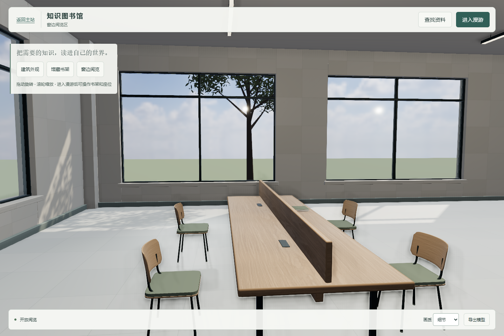
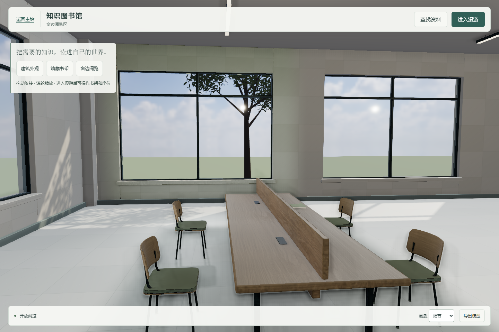
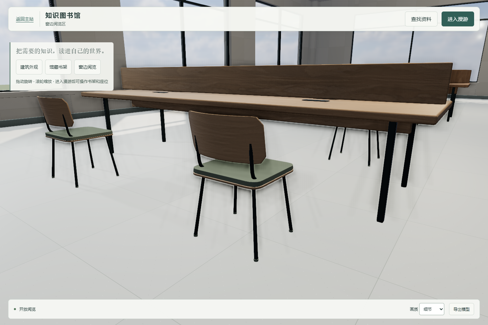
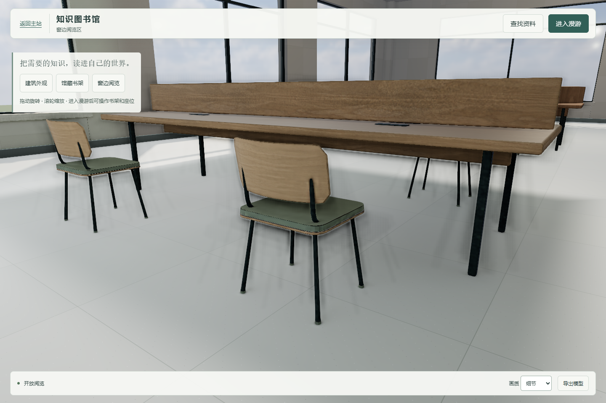

# R1 真实局部烘焙与视觉优化

承接 PR #42 的准备资产 `c75a5e2`，用户在本轮明确将独立 UV 和实际烘焙交给 C。已核对最新 main `b625413ac1f5eee07011590e2a3c9025ee81191d`，其图书馆输入和相关后端文件与准备基线一致。#42 尚未合并，本 PR 以其分支为基底，避免重复提交准备成果。范围仍为 R1 一组桌椅及对应局部地面／窗墙，不修改 A/B/D，不改 #41 的释放测试，不合并或部署。[版本和资源哈希](version-audit.json)。

## 当前画面与边界

本轮真实制作 UV1、Cycles 光照图并接回可行走应用，而非仅交方案。旧相机、纵向 FOV 55°、1440×960、DPR 1、细节画质与曝光 1 保持；以下是同一应用切换真实烘焙／旧实时方案的实际浏览器截图，没有生成图或后期提亮。

| 机位 | 原实时方案 | 本轮真实烘焙 |
|---|---|---|
| 整体 |  |  |
| 桌椅近景 |  |  |

[背光面实拍](baked-backlit.png) · [窄屏实拍](baked-narrow.png)。背光面相机仍为 `[4.2,1.65,-3.1]` → `[8.2,0.9,-4.5]`。整体与单椅相机仍是准备说明中的 sample／chair，没有挪动家具来获得对比。

变化：椅背、桌中隔板和桌下地面获得有遮挡的天空漫射与反弹光，墙窗与桌椅使用同一计算结果；木材加入低强度清漆，织物加入纤维掠射高光。没有增加实时灯、改变全馆曝光或投射参考照片。当前窗外大地面、其他区域及部分细部仍显原型，不能把这次增量写成全馆照片级验收。

## 真实制作内容

- 用已验收的全馆外壳／既有场地参与离线遮挡、反弹求解，避免直接拿开放的东翼裁剪边界当完整 GI 域；仅导出接收面与保持原场景其余部分所需的几何补集。原完整 GLB 和 Blender 的 SHA 保持，未重做家具。
- 47 个接收面：35 个 R1 桌椅固定构件、1 个桌下地面补丁、11 个对应窗墙／窗框构件。没有把玻璃、门、书本、角色或其他桌椅设成新接收面。另有 3 个无 lightmap 的原地面／墙窗框补集，所以运行模型为 50 个网格。
- 保留 UV0，新增独立 UV1。原家具和窗墙部件逐三角形属性核对：位置最大误差 0，UV0 最大误差约 `1.2e-7`；Blender 自定义法线编码引入约 `0.000362` 分量误差。原地面与补丁／补集的总表面积分别约 `921.240952138`、`921.240952140 m²`，没有叠加重合薄片。1024² UV1 栅格检查未发现重叠；这不是针对无限精度所有微小三角形的形式证明。
- Blender 4.5.3 / Cycles / RTX 5070 Laptop OptiX，2048 atlas，256 采样，5 次漫反射反弹；分别计算单位均匀天空的完整漫射及太阳的间接光，再线性合成，OIDN 颜色去噪，输出 16-bit RGB ZIP EXR。天空为线性 RGB `[.78,.86,1]`、最终 gain 3.5，这是明确选择的光照参数，并非实测 HDR 照度。太阳沿用 `[18,23,17]` → 原点、强度 2.65。
- 白色 Lambert 面在单位白天空下实测漫射烘焙均值 `[1,1,1]`；Three lightMap 输入为 irradiance，故接入强度为 π。没有把含 albedo、曝光或色调映射的 beauty 图当光照图。Atlas 本身是线性白色漫射辐亮度，旧贴图继续实时提供材质颜色。
- 太阳直射不烘进 atlas，继续实时计算直接光／阴影。R1 接收材质替换旧半球／环境漫射及点／聚光辅助漫射，保留 HDR 镜面和实时太阳，避免重复照明。局部地面边缘 0.5m、窗墙 Z 边缘 0.8m 向旧方案过渡。SSAO 仍按原画质选项运行，可能与细小接触遮挡叠加，未声称是完整实时 GI。

## 接入、所有权与运行

`src/r1-lighting.js` 加载 `assets/r1-lighting/r1-bake.json` 指定的哈希文件：约 2.7MB 接收几何、8.4MB EXR。GLB 只存几何／UV／原材质名，运行时借用原 PBR 纹理；没有重复嵌入整馆材质。

`uv1` 对应 lightMap 的 channel 1。EXRLoader 返回底向上的数据，本模块显式翻行一次，与 glTF UV 的方向一致；用线性色彩空间、half-float、mipmap 和 atlas padding。2048 RGBA half-float 加 mip 约需额外 43MiB GPU 纹理空间，另有接收几何和着色成本；初次还需下载新资源。本轮只做桌面和窄屏模拟，没有物理手机显存与长期运行保证。

`app.init()` 在首次可操作前上传 atlas、预绘 R1 并等待 GPU fence，再恢复用户请求的相机。首轮未预热时实测转向有一次约 1.1s 卡顿；修正把这笔工作放入加载阶段，代价是首次加载更长。没有过滤行走时的长帧来美化结果。元数据按 no-cache 拉取，二进制文件按内容哈希命名，页面 bundle 入口增加版本号。

该模块拥有 50 份几何、8 个接收材质克隆和 1 张 atlas；原 PBR 贴图只借用。非 BFCache 离页先释放并移除私有对象，再由原流程释放旧场景，重复 dispose 幂等；BFCache 仅暂停，不销毁仍需恢复的 atlas。请求失败／UV1 缺失会回滚到完整实时场景。新异步资源支持加载中取消，不向已释放场景安装迟到对象。

真实后端静态白名单只新增 R1 清单、`r1-receivers-xxxxxxxx.glb` 和 `r1-indirect-xxxxxxxx.exr`；烘焙源码和 Blender 文件仍禁止经该入口访问。主站入口和返回 `#wenku` 沿用原实现。调试可调用 `__library.reviewBake(false/true)`；原 `reviewR1` 三档明确切回旧实时方案，历史对比仍可复验。

模型导出仍可运行，导出 GLB 有 UV1 和配套 atlas 元数据；标准 glTF PBR 没有本项目的自定义 lightmap 组合逻辑，因此独立查看器不会自动呈现与浏览器相同的间接光。保留原 `assets/wenku-library.glb`、`Library_Editable.blend` 作已验收源，新的烘焙工作文件在独立交付输出，不覆盖原件。

## 验证记录

- 新光照专项 11 项通过：真实 atlas、同页前后对比、原场景回切、八座 24 次循环、流畅／窄屏、明确资源各一次释放、重复 dispose、503 回退、缺 UV1 回滚、加载中取消、实际后端加载及资源边界、实际 BFCache 往返。专项使用完整 Chromium，显式去掉 Playwright 默认关闭 BFCache 的参数；不能用不支持该检查的默认 headless shell 代替。见 [专项原始结果](r1-lighting-results.json)。
- 原图书馆 23 项通过：真实 PDF、私有上传／退出清理、404、门与行走、座位、窄屏、子目录、实际 GLB 导出。使用独立本地后端和 DATA_DIR，没有连接生产账号。见 [业务原始结果](acceptance-results.json)。
- server check 通过：34 个前端文件、412 个 HTML ID。没有改 #41 测试或重跑 A/B 全量验收。
- 几何／UV 校验、单位照度校验、Blender 保存／图像打包、真实运行截图及持续移动均有原始记录。

Chromium 无头 / Intel Graphics / ANGLE D3D11，流畅画质连续 W+L：

| 场景 | 时长 | RAF 次/秒 | P95 | 最大间隔 | >50ms |
|---|---:|---:|---:|---:|---:|
| 1440×960 桌面 | 20s | 60.0 | 16.7ms | 33.4ms | 0 |
| 390×844 窄屏模拟 | 12s | 60.0 | 16.7ms | 16.8ms | 0 |

以上是当前同机测量，RAF 不等于实体显示 FPS，也不代表其他硬件或物理手机。[正式记录](performance-results.json)、[预热修正前记录](performance-before-warm.json)、[几何与 UV](uv-audit.json)、[单位校验](calibration.json)、[烘焙过程](bake-report.json)、[整理与打包](finish-validation.json)、[保存后实际重开检查](reopen-validation.json)。

## 复现与后续

现有 Blender（带 NumPy）即可运行，不安装新重型环境。在仓库根目录执行：

```text
blender -b --factory-startup --python-exit-code 1 --python examples/library-3d/tools/bake-r1.py -- . OUTPUT 2048 256
blender -b --factory-startup --python-exit-code 1 --python examples/library-3d/tools/finish-r1-bake.py -- . OUTPUT 3.5
python examples/library-3d/tools/audit-r1-lighting.py --repo . --output AUDIT_OUTPUT
```

准备输入仍锁定 #42 和原已验收 GLB／Blender；原文件直接引用，未重新导出整馆作为运行资源。动态物体没有固定进光照图，但静态桌椅、树和遮挡若改变，间接光必须重烘焙。当前没有人物间接光探针或全馆统一烘焙。下一步可按实际截图继续评估窗外环境、材质微细节及其他区域是否推广，不能以本次局部效果代替全馆验收。
